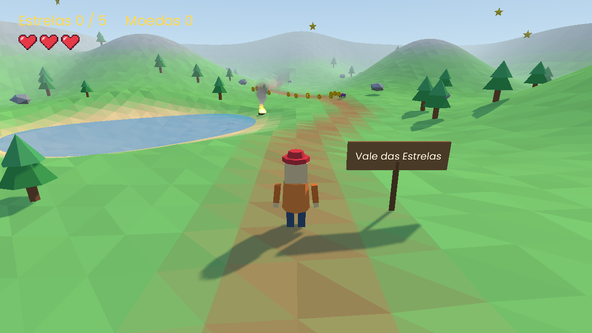

# Comece aqui no 3D

A nn-engine faz jogos 3D em terceira pessoa com visual low-poly colorido:
um herói que anda, pula e leva a câmera atrás dele, num mundo com céu, sol,
névoa, sombras, física, terreno, inimigos, portas, itens e personagens que
conversam. Dá para montar tudo no **NN Studio, sem código**, ou escrever em
**Lua** com a API `nn.d3`.

Este guia mostra por onde começar e onde está cada coisa. Os detalhes ficam
no [guia do NN Studio](studio.md#cenas-3d) e no [guia do Lua](lua.md#nnd3-3d).

## Primeiro contato (5 minutos)

1. Abra o NN Studio e, nas boas-vindas, escolha **3D**. Clique em
   **🎮 Abrir um jogo pronto** e crie o projeto: é a **ilha das estrelas**,
   montada sem código.
2. Aperte **▶ Jogar (F5)**. WASD anda, espaço pula, o mouse gira a câmera e
   **E** fala com o pescador. Esc solta o mouse.
3. Volte ao editor. A vista 3D abre olhando para o herói:
   - segure o **botão direito** e use **WASD** para voar;
   - clique num objeto para ver os componentes dele no Inspetor;
   - o placar e os corações aparecem por cima, na moldura da tela do jogo.
4. Mude alguma coisa (o sol em **☀ Ambiente**, a velocidade do herói no
   **Jogador 3D**) e jogue de novo.

Já tem projetos e não vê as boas-vindas? **✨ Novo projeto > Jogos 3D > 3D**.

## Aprender fazendo: os tutoriais

Em **🎓 Tutoriais > Jogos 3D**, cada tutorial cria um projeto a partir do
modelo **Vazio 3D** e mostra um passo de cada vez, destacando o botão certo e
avançando sozinho. A ordem sugerida:

| Tutorial | O que você monta | Tempo |
|---|---|---|
| **Seu primeiro mundo 3D** | Herói animado que anda e pula, árvores que bloqueiam, uma caixa que cai, um bicho que anda, uma estrela, uma plataforma que anda, o sol da tarde e um evento de vitória | 15 min |
| **Efeitos no 3D** | Fogueira com fogo, fumaça e som (mais alto de perto), poeira ao pular e chuva | 10 min |
| **Pinte um terreno** | Morros, um lago com água, cores de grama, pedra e areia e árvores espalhadas com o pincel | 12 min |
| **Inimigos no 3D** | Vida, corações na tela, um besouro que persegue (e morre se você pular em cima) e lava | 12 min |
| **Portas e chaves** | Uma porta que abre com E, trancada até achar a chave, o inventário, uma placa e uma zona de gatilho | 10 min |
| **Uma conversa** | Um personagem que fala, com falas e escolhas montadas no editor de conversa | 12 min |

Depois dos tutoriais, abra os modelos prontos para ver tudo junto:

- **3D**: a ilha (estrelas, plataformas, besouros, cofre trancado, pescador);
- **Vale 3D**: um vale pintado num terreno, com trilha, lago e besouros.

## As peças prontas

No NN Studio, um jogo 3D é feito de **objetos** com **componentes** e
**comportamentos**:

| Para | Use | No guia |
|---|---|---|
| Formas e modelos | **Forma 3D** (cubo, esfera...) e **Modelo 3D** (`.glb`) | [Objetos 3D](studio.md#objetos-3d) |
| O herói | **Jogador 3D**: anda, pula, câmera atrás, animações sozinho | [Jogador 3D](studio.md#jogador-3d) |
| Chão, paredes, caixas | **Corpo 3D** (parado, que cai ou que se move) | [Física](studio.md#física-corpo-3d) |
| Personagens animados | **Animação 3D** (um `.glb` com esqueleto) | [Animação 3D](studio.md#animação-3d) |
| Morros e lagos | **Terreno**, pintado com o mouse | [Terreno](studio.md#terreno) |
| Fogo, chuva, sons | **Partículas** e **Som** no mundo 3D | [Som e partículas](studio.md#som-e-partículas-no-3d) |
| Moedas e estrelas | **Coletável** e **Girar e flutuar** | [Comportamentos](studio.md#comportamentos-e-eventos-no-3d) |
| Plataformas e elevadores | **Plataforma que anda** | [Comportamentos](studio.md#comportamentos-e-eventos-no-3d) |
| Inimigos e dano | **Inimigo 3D**, **Vida**, **Perigo** | [Inimigos](studio.md#inimigos-vida-e-dano-no-3d) |
| Portas, chaves, zonas | **Porta 3D**, **Interagir**, **Mostrar inventário**, **Zona de gatilho** | [Portas](studio.md#portas-chaves-e-zonas) |
| Conversas | **Diálogo** e o editor de conversa | [Editor de conversa](studio.md#editor-de-conversa) |
| Placar e menus | **Na tela (HUD)**: texto, ícones, barras, botões | [HUD no 3D](studio.md#hud-e-menus-no-3d) |
| Regras do jogo | **Eventos** "Quando... Então..." | [Eventos](studio.md#eventos-quando-então) |

## Modelos: do Blender (ou do Mixamo) para o jogo

- Exporte do Blender em **glTF 2.0**, formato **glb** (*Arquivo > Exportar*),
  e arraste o arquivo para o painel Arquivos. Arrastado para a vista 3D, vira
  um objeto em pé no chão onde o mouse aponta.
- **1 unidade = 1 metro.** O herói dos modelos tem 1,8 m, com a origem nos
  pés.
- A frente do personagem é o **+Z** no jogo (no Blender, olhando para −Y, a
  vista de frente).
- Cada *Action* do Blender vira uma animação com o mesmo nome. O Jogador 3D
  procura `parado`, `andar`, `correr`, `pular` e `cair` (dá para trocar os
  nomes no Inspetor).
- Do Mixamo: veja [o guia do Lua](lua.md#animações-personagens-com-esqueleto).

## Em código (Lua)

Prefere programar? Crie um projeto com o modelo **3D em código**: a mesma
ilha, escrita em Lua (com título, pausa, cronômetro e recorde). O guia
[Seu primeiro jogo 3D](lua.md#seu-primeiro-jogo-3d) explica as peças do
projeto e como mudar a fase, o herói e as regras. A referência fica em [`nn.d3`](lua.md#nnd3-3d) e
[`nn.physics3d`](lua.md#nnphysics3d-física-3d). Cenas visuais e código se
misturam: uma cena visual pode ter um script, e um comportamento seu (em Lua)
aparece no Inspetor como os prontos.

## Desempenho

- O que fica fora da vista da câmera não é desenhado, e cópias do mesmo
  modelo (mil árvores iguais) são desenhadas juntas. Uma cena com centenas de
  árvores, pedras e moedas roda leve.
- O que mais pesa: **sombras** (a distância delas, em ☀ Ambiente), muitas
  **partículas** ao mesmo tempo e modelos com muitos triângulos (o visual
  low-poly ajuda).
- Para medir no seu jogo, mostre `nn.d3.stats()` na tela: quantas malhas
  foram pedidas, quantas a câmera viu, quantas foram para as sombras e as
  chamadas de desenho.

## Quando algo dá errado

| Aconteceu | O que fazer |
|---|---|
| Um **cubo rosa** no lugar do modelo | O arquivo do modelo não existe ou não abriu. O console (filtro **Avisos**) diz qual objeto e qual arquivo. |
| O herói **atravessa** o chão ou as paredes | O chão e as paredes precisam de um **Corpo 3D**. Ligue **Colisões**, na barra da cena, para ver os corpos. |
| O herói **cai para sempre** | Ele começa abaixo do chão, ou o chão não tem corpo. Suba o herói com a seta verde (Y). |
| A cena some **na névoa** no editor | De longe, a névoa esconde tudo: desmarque **Névoa** na barra (só no editor). |
| O modelo está **gigante ou minúsculo** | A escala do Blender: use 1 unidade = 1 metro, ou ajuste a **Escala** no Inspetor. |
| O personagem **anda de lado ou de costas** | A frente do modelo não é o +Z. Gire no Blender, ou gire o objeto 90° ou 180° em Y. |
| Um som some ou uma conversa não abre | O arquivo não existe: o aviso no console diz qual. |

Dúvidas e ideias: [issues do repositório](https://github.com/nereuneto/nn-engine/issues).
