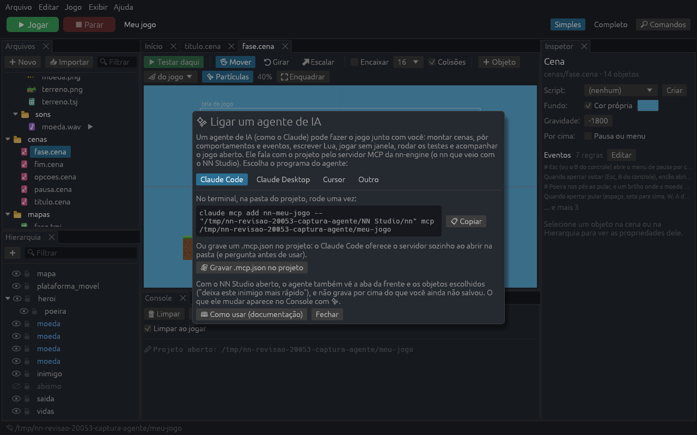

# O servidor MCP: desenvolver com um agente de IA

A ferramenta `nn` tem um **servidor MCP** (Model Context Protocol). Ele liga um agente de IA (Claude Code, Claude Desktop, Cursor ou outro cliente MCP) a um projeto de jogo. O agente conhece o projeto, monta cenas, põe comportamentos e eventos, escreve scripts Lua e confere o que fez, tudo pelas mesmas regras do NN Studio. O que ele grava o editor abre igual, e o contrário também. Ele também **joga o jogo sem janela**, com teclas e cliques simulados, e vê os erros, o que mudou e a tela, roda os **testes de jogo** do projeto e acompanha o **jogo aberto** enquanto você joga, mudando valores na hora.

```
nn mcp <pasta-do-jogo>
```

O servidor conversa com o agente pela entrada e saída padrão: quem abre o `nn mcp` é o próprio cliente, configurado como mostrado abaixo (ou pelo NN Studio, em **Jogo > Ligar um agente de IA**). Ele só mexe em arquivos **dentro da pasta do jogo**, e **cada mudança pode ser desfeita** (ferramenta `desfazer`).

## Ligar no seu agente

O jeito mais fácil é pelo NN Studio: com o projeto aberto, **Jogo > Ligar um agente de IA…** mostra o comando ou a configuração de cada cliente, já com o caminho do `nn` e da pasta, com um botão para copiar. Ele também grava a configuração para você: o `.mcp.json` do projeto (Claude Code), a do Claude Desktop (guardando uma cópia da de antes) ou o `.cursor/mcp.json` (Cursor).



À mão: o `nn` vem nos pacotes da release:

- **Windows (instalador):** `C:\Users\<você>\AppData\Local\Programs\NN Studio\nn.exe`.
- **Windows (zip portátil) e Linux (tar.gz):** o `nn` fica na pasta que você extraiu.
- **Linux (AppImage):** `NN-Studio-<versão>-x86_64.AppImage nn mcp <pasta>` roda o `nn` que vem dentro dele.

Nos exemplos abaixo, troque `nn` pelo caminho completo se ele não estiver no PATH.

### Claude Code

De dentro da pasta do jogo:

```
claude mcp add nn -- nn mcp .
```

Com `--scope project`, a configuração vai para um `.mcp.json` na pasta. Quem abrir o projeto com o Claude Code ganha o servidor também. Sem a pasta (`nn mcp`), o servidor usa a do projeto que o Claude Code abriu, e o `.mcp.json` pode levar `"args": ["mcp", "${CLAUDE_PROJECT_DIR:-.}"]`. Para ver se ligou, use `/mcp` dentro do Claude Code.

No Windows, com o instalador:

```
claude mcp add nn -- "C:\Users\<você>\AppData\Local\Programs\NN Studio\nn.exe" mcp .
```

### Claude Desktop

Em **Configurações > Desenvolvedor > Editar configuração**, no `claude_desktop_config.json`:

```json
{
  "mcpServers": {
    "nn": {
      "command": "C:\\Users\\<você>\\AppData\\Local\\Programs\\NN Studio\\nn.exe",
      "args": ["mcp", "C:\\Users\\<você>\\Documents\\meu-jogo"]
    }
  }
}
```

Reabra o Claude Desktop depois de salvar.

### Cursor e outros

Qualquer cliente MCP que abre servidores locais (stdio) serve. O comando é o `nn`, e os argumentos são `mcp` e a pasta do jogo. No Cursor, num `.cursor/mcp.json` dentro do projeto:

```json
{ "mcpServers": { "nn": { "command": "nn", "args": ["mcp", "."] } } }
```

## Começar

Peça ao agente o que você quer, do jeito que pediria a uma pessoa: *"faz uma fase de plataforma com três moedas e uma porta que só abre com todas"*. O servidor diz ao agente como trabalhar, e todo projeto novo vem com um `AGENTS.md` que explica a organização dele.

Numa pasta vazia, o agente cria o jogo a partir de um modelo (`criar_projeto`). Há também dois **prompts** prontos:

- `criar_jogo`: faz um jogo do começo, a partir de uma ideia;
- `melhorar_jogo`: faz uma mudança pedida no jogo aberto.

No Claude Code eles aparecem como `/mcp__nn__criar_jogo` e `/mcp__nn__melhorar_jogo`.

## As ferramentas

| Ferramenta | O que faz |
|---|---|
| `ver_projeto` | O jogo: título, 2D ou 3D, tela, cena inicial, variáveis e todos os arquivos. Numa pasta vazia, os modelos. |
| `criar_projeto` | Cria um jogo a partir de um modelo (`visual`, `aventura`, `nave`, `visual3d`, `vale3d`, `padrao`, `3d`, `vazio`, `vazio3d`, `minimo`). |
| `mudar_config` | Muda o `config.lua` sem perder os comentários: título, cena inicial, tamanho, variáveis do jogo e tema. |
| `conferir_projeto` | Confere tudo sem rodar o jogo: sintaxe dos scripts, cenas que não abrem, arquivos citados que não existem, comportamentos e eventos desconhecidos, componentes que faltam. |
| `listar_arquivos`, `ler_arquivo` | Os arquivos do projeto. Uma imagem volta como imagem, para o agente ver (e o tamanho, para os quadros de uma spritesheet). |
| `escrever_arquivo`, `apagar_arquivo` | Scripts, mapas, diálogos. Um Lua com erro de sintaxe **não é gravado**: volta a linha e o erro em português. |
| `desfazer` | Volta as últimas mudanças feitas pelo agente. |
| `ver_cena` | Uma cena ou um prefab em JSON, no formato do arquivo, com as regras de eventos em frases. |
| `criar_cena`, `mudar_cena` | Cenas 2D ou 3D, a cor do fundo, a gravidade, o ambiente 3D (céu, sol, névoa). |
| `criar_objeto`, `mudar_objeto`, `copiar_objeto`, `apagar_objeto` | Objetos com componentes e comportamentos, cada campo conferido. Também filhos, fileiras de cópias e trocar de pai. |
| `criar_prefab` | Transforma um objeto num prefab. Mudar o prefab muda todas as cópias. |
| `listar_componentes`, `listar_comportamentos` | Os componentes (com os campos e padrões) e os comportamentos prontos e do projeto (com as propriedades, opções e ajuda). |
| `listar_eventos`, `por_regra`, `tirar_regra` | Os eventos "Quando... Então..." sem código. |
| `criar_imagem`, `desenhar`, `ver_imagem` | **Pixel art:** cria uma imagem (com quadros para animar), desenha com várias operações numa chamada (o mais prático: o desenho como texto, um caractere por pixel) e mostra a imagem ampliada. Veja [Pixel art](#pixel-art). |
| `quadros`, `animar` | Os quadros de uma folha de sprites e as animações com nome (o `.anim`, o mesmo do NN Studio), com a tira dos quadros na ordem em que tocam e a casca de cebola. |
| `criar_mapa`, `pintar_mapa`, `ver_mapa`, `marcar_tiles` | **Mapas de tiles** (`.tmj`, o formato do Tiled que o NN Studio edita): cria de uma imagem de tiles, pinta (com desenho como texto e terreno automático), marca os tiles sólidos e mostra o mapa desenhado. Veja [Mapas, partículas, sons e diálogos](#mapas-partículas-sons-e-diálogos). |
| `particulas` | Um efeito de partículas pronto (fogo, fumaça, faíscas, explosão, chuva...) num objeto, ajustes e uma prévia do efeito em quatro momentos. Com `pixel`, quadradinhos de pixel art. |
| `criar_som` | Um **efeito sonoro** sintetizado (`.wav`): moeda, pulo, tiro, laser, explosão, power-up, dano, clique, blip, com variações e ajustes. Volta a forma da onda e a nota ao longo do tempo. |
| `escrever_dialogo`, `ver_dialogo` | **Conversas** (`.dialogo`, as do editor de conversa): falas, escolhas, variáveis e itens, em JSON de ida e volta. |
| `buscar_documentacao` | A API Lua `nn.*` e os guias (este, o de Lua, o de 3D e o do NN Studio): os trechos que citam as palavras, ou uma seção inteira (`secao`). |
| `conferir_lua` | A sintaxe de um trecho de Lua, sem gravar. |
| `rodar_jogo` | Roda o jogo **sem janela**, com teclas e cliques simulados, e mostra os erros (com arquivo e linha), avisos, prints, as regras que dispararam, as trocas de cena, o que mudou nos objetos e variáveis, e **capturas da tela** (com `ver_corpos`, os corpos da física desenhados por cima). Veja [Rodar e ver](#rodar-e-ver). |
| `rodar_testes` | Roda os [testes de jogo](lua.md#testes-de-jogo) do projeto (`testes/*.lua`) e mostra quem falhou, a linha, os prints e a tela na hora da falha. |
| `abrir_jogo` | Abre o jogo **numa janela** no seu computador (você vê e pode jogar junto) e liga nele. Veja [O jogo aberto](#o-jogo-aberto). |
| `ver_jogo_aberto` | Olha o jogo aberto (por `abrir_jogo`, pelo ▶ Jogar do NN Studio ou por `nn .`) enquanto alguém joga: a cena, os erros, prints e regras desde a última olhada, o que mudou e a tela. |
| `mexer_no_jogo` | Muda o jogo aberto **na hora, sem gravar**: campos de objetos e comportamentos, variáveis, Lua, teclas como se alguém jogasse; pausa, avança quadros e fecha. |
| `ver_editor` | Olha o NN Studio aberto com o projeto: a aba da frente, os **objetos escolhidos** (de quem você fala quando diz "este"), o que ainda não foi gravado e a imagem da janela. Veja [Junto com o NN Studio](#junto-com-o-nn-studio). |

São 43. Os guias também vão para o agente como **recursos** (`nn://docs/lua.md`, `nn://docs/3d.md`, `nn://docs/studio.md`, `nn://docs/mcp.md` e `nn://projeto/AGENTS.md`).

## Objetos no formato do arquivo

`ver_cena` mostra os objetos como estão no `.cena`, só com o que difere do padrão (`completo: true` mostra tudo). `criar_objeto` aceita o mesmo formato:

```json
{
  "name": "heroi", "x": -400, "y": -200, "layer": 2,
  "components": [
    {"type": "sprite", "image": "assets/imagens/heroi.png", "frame_w": 16, "frame_h": 16, "w": 64, "h": 64},
    {"type": "behavior", "script": "nn:plataforma", "velocidade": 300},
    {"type": "behavior", "script": "nn:vida", "vidas": 3}
  ]
}
```

- `type` é um componente (`sprite`, `shape`, `text`, `body`, `camera`, `particles`, `button`, `model`, `body3d`...) ou um comportamento: `"behavior"` com o `script` (`"nn:plataforma"`, ou o caminho de um `.lua` do projeto). Também vale só `"type": "nn:plataforma"`.
- Os campos que faltam ficam com o padrão. Cada campo é conferido: um nome errado, um tipo errado, uma cor fora do formato ou uma opção que não existe voltam como erro, com a lista do que vale.
- Um comportamento que precisa de corpo físico (`nn:plataforma`, `nn:patrulha`...) já ganha um, como no NN Studio.
- Uma cópia de prefab: `{"name": "moeda2", "prefab": "prefabs/moeda.prefab", "x": 100, "y": 0}`.
- No 2D, as medidas são em pixels, com y para cima e (0, 0) no meio da tela. No 3D, são em metros, e y é a altura.

As regras de eventos também vão no formato do arquivo:

```json
{
  "when": [{"cond": "pegar", "quem": "@jogador", "item": "moeda"}],
  "actions": [{"act": "som", "som": "assets/sons/moeda.wav"}]
}
```

## Rodar e ver

`rodar_jogo` roda o jogo sem janela: 60 quadros por segundo de jogo, o mais rápido que der (não no tempo do relógio), sem som, com o `math.random` sempre na mesma sequência e com o salvo (`nn.save`) só na memória. Rodar não mexe nos recordes de quem joga.

O jogador é simulado com **ações**, cada uma no seu tempo (`em`, em segundos desde o começo):

```json
{
  "cena": "cenas/fase.cena",
  "segundos": 3,
  "acoes": [
    {"em": 0.2, "segurar": "right", "por": 1.5},
    {"em": 1.0, "apertar": "space"},
    {"em": 1.2, "capturar": "no pulo"}
  ],
  "objetos": ["heroi"],
  "olhar": ["nn.vars.moedas"]
}
```

| Ação | O que faz |
|---|---|
| `"apertar": "space"` | Aperta e solta a tecla. |
| `"segurar": "right", "por": 1.5` | Segura a tecla (sem `por`, até o fim). |
| `"soltar": "right"` | Solta uma tecla segurada. |
| `"clicar": [x, y]` | Clica num ponto da tela (pixels, y para baixo). Com `"botao": "right"`, o botão direito. |
| `"clicar": "jogar"` | Clica no objeto com esse nome (um botão do menu, por exemplo). |
| `"mouse": [x, y]` | Põe o mouse num ponto, sem clicar. |
| `"digitar": "Nereu"` | Escreve num campo de texto. |
| `"capturar": true` ou `"capturar": "nome"` | Guarda uma captura da tela agora. |
| `"lua": "self.objects.heroi:move_to(0, 0)"` | Roda código com `self` = a cena da frente: para preparar a situação (levar o herói até a porta, mudar uma variável). |

Com `"ver_corpos": true`, as capturas mostram os **corpos da física** por cima: cinza o que é parado, verde o que cai, azul o que se move sozinho (o personagem 3D, uma plataforma) e amarelo os sensores. Serve quando algo não encosta, atravessa ou fica parado no ar.

As teclas têm os nomes do `nn.input`: `a` a `z`, `0` a `9`, `space`, `enter`, `escape`, `left`, `right`, `up`, `down`, `shift`, `ctrl`, `alt`, `tab`... Sem `cena`, o jogo começa na cena inicial do `config.lua`. Com `"segundos": 0`, só mostra a primeira tela.

A resposta conta o que aconteceu, com o tempo de cada coisa:

```
Rodou 3.00 s de jogo (180 quadros), começando em cenas/fase.cena.

Erros: nenhum.

Regras dos eventos que dispararam:
  1.00 s  cenas/fase.cena: regra 4 da cena: quando tecla e no_chao → soltar_particulas
  1.70 s  cenas/fase.cena: regra 5 da cena: quando pegar → criar

O que mudou em cenas/fase.cena do começo ao fim:
  heroi (5): x 0 → 480, y -180 → -210
  moeda (8): sumiu (destruído)
  moedas (15): text.text "Moedas: 0" → "Moedas: 1"
Variáveis que mudaram: moedas 0 → 1
```

e traz as capturas (a do fim e as pedidas) como imagens. Se um script dá erro, o jogo para ali, e a resposta mostra o erro com o arquivo e a linha. Um laço sem fim (`while true do end`) vira erro depois de 5 segundos, em vez de travar o servidor.

Para conferir o que importa de novo depois de cada mudança, o agente escreve **testes de jogo** em `testes/` e roda com `rodar_testes`. Os testes estão no [guia de Lua](lua.md#testes-de-jogo); `nn testar` roda os mesmos testes no terminal.

## Pixel art

O agente desenha as imagens do jogo com as mesmas operações do editor de pixel art do NN Studio, e vê cada passo ampliado (pixels grandes, xadrez no transparente, uma linha rosa entre os quadros):

```json
{
  "caminho": "assets/imagens/slime.png",
  "operacoes": [
    {"desenho": ["..GG..", ".GGGG.", "GGWGWG", "GGGGGG"],
     "cores": {"G": "#38b764", "W": "#f4f4f4"}, "em": [1, 1]},
    {"contorno": true, "cor": "#1a1c2c"}
  ]
}
```

- `criar_imagem` cria a imagem com um tamanho (16x16 e 32x32 são comuns) e quantos **quadros** lado a lado, para animar.
- `desenhar` desenha num quadro (x para a direita, y para baixo, (0, 0) no canto de cima à esquerda): `desenho` (texto, um caractere por pixel, e a cor de cada caractere), `pontos`, `linha`, `retangulo`, `elipse`, `balde`, `apagar`, `trocar_cor`, `espelhar`, `simetria` (copia uma metade espelhada na outra), `deslocar`, `contorno` e `copiar_quadro`. As cores são `"#rrggbb"`, `"transparente"` ou o número da cor numa paleta (a do projeto, `paleta.hex`, ou as prontas: Sweetie 16, PICO-8, Endesga 32). Uma operação pode ter o seu `quadro` (todos os quadros de uma animação numa chamada), e `cores` na chamada vale para todos os `desenho` dela.
- `ver_imagem` mostra a imagem, o tamanho, os quadros, as animações e as cores usadas; com `texto`, o quadro como texto, para conferir pixel a pixel (com `cores`, nos mesmos caracteres do desenho); com `repetir`, o quadro lado a lado, para ver as emendas de um tile.
- `quadros` põe, tira e troca quadros (as animações acompanham), e divide a imagem em quadros.
- `animar` cria uma animação com nome (`parado`, `andar`...): os quadros na ordem, o fps e se repete. O comportamento `nn:animacao` toca `parado`, `andar`, `pular` e `cair` sozinho.

Tudo vira o mesmo `.png` e `.anim` que o NN Studio grava, e o `desfazer` volta.

Num jogo de 1280x720, um sprite de 16x16 fica pequeno. Para pixel art, o jogo costuma ter uma tela pequena com os pixels inteiros (`mudar_config` com `"resolution": [320, 180]` e `"scale": "pixel"`), e as capturas do `rodar_jogo` vêm ampliadas (`ampliar` escolhe quanto). Num sprite com `fill = "repeat"` (um chão de tiles), `w` e `h` são o tamanho de cada cópia, e a escala do objeto diz quantas cabem.

## Mapas, partículas, sons e diálogos

**Mapas de tiles.** `criar_mapa` cria o mapa (`.tmj`) de uma imagem de tiles (feita com `criar_imagem`, um quadro por tile) ou de um tileset (`.tsj`), e mostra os tiles numerados. Os números são os do mapa: o 1 é o tile do canto de cima à esquerda da imagem. No mapa, a coluna 0 fica à esquerda e a linha 0 em cima.

```json
{
  "caminho": "mapas/fase.tmj",
  "operacoes": [
    {"desenho": ["....==....", "##########"], "tiles": {"#": 1, "=": 2}, "em": [0, 10]},
    {"terreno": "grama", "retangulo": [12, 8, 6, 3]}
  ]
}
```

- `pintar_mapa` faz várias operações numa camada: `tile` com `retangulo`, `linha`, `pontos` ou `balde`, `apagar`, `desenho` (um caractere por tile) e `terreno`. Também cria camadas (`criar_camada`), liga a colisão da camada inteira (`colisao`) e aumenta o mapa (`tamanho`). Volta o mapa desenhado.
- `marcar_tiles` diz quais tiles bloqueiam (`solidos`), quais são plataformas de mão única (`plataformas`) e o tipo livre de cada um (`"tipo": {"lava": [7]}`), que os eventos usam. Com `terreno`, ensina as 16 peças de um terreno (`"primeiro": 5`: o tile 5+m tem terreno nos cantos dos bits de m), e o `pintar_mapa` com `terreno` acerta as bordas e os cantos sozinho.
- `ver_mapa` mostra o mapa, as camadas, os tilesets, os sólidos e os terrenos; com `texto`, uma camada como texto.
- Na cena, um objeto com `{"type": "map", "map": "mapas/fase.tmj"}`: o objeto é o canto de **baixo** à esquerda do mapa.

**Partículas.** `particulas` põe um efeito pronto num objeto (e cria o objeto, se não existir) e mostra o efeito sozinho em quatro momentos, recortado em volta dele. `mudar` troca campos do componente (`listar_componentes particles`), `escala` multiplica tamanhos e velocidades, e `pixel` desenha quadradinhos de tamanho inteiro, sem girar. Numa tela pequena, um efeito com `pixel` já vem na escala dela.

**Sons.** `criar_som` sintetiza um efeito sonoro como o sfxr: escolha o `tipo`, troque a `variacao` (cada número é sempre o mesmo som) até gostar e ajuste com `mudar` (`freq`, `freq_fim`, `deslize`, `onda`, `queda`...). Como o agente não ouve, volta uma imagem com a forma da onda (o volume ao longo do tempo) e a nota (mais alto = mais agudo). Os números ficam num `.sfx` ao lado do `.wav`: chamar de novo com o mesmo caminho ajusta o som, e o NN Studio abre o mesmo `.sfx` em **🎛 Ajustar efeito**.

**Diálogos.** `escrever_dialogo` grava a conversa inteira:

```json
{
  "caminho": "dialogos/ana.dialogo",
  "falas": [
    {"id": "oi", "quem": "Ana", "texto": "Oi! Viu minha chave?"},
    {"id": "pergunta", "quem": "Ana", "texto": "Me ajuda?", "escolhas": [
      {"texto": "Claro", "vai": "valeu", "variavel": "ajudou", "valor": 1},
      {"texto": "Agora não", "vai": "fim"}
    ]},
    {"id": "valeu", "quem": "Ana", "texto": "Valeu! Tome.", "item": "moeda"}
  ]
}
```

Sem `depois`, uma fala vai para a próxima da lista, e a última termina; o fim de um ramo de escolha precisa de `"depois": "fim"`. A resposta conta a conversa pelos caminhos e avisa de falas que nunca aparecem. `ver_dialogo` devolve a conversa no mesmo formato, para mudar e mandar de volta. Na cena, um personagem com o comportamento `nn:dialogo` e `"arquivo"`.

## O jogo aberto

Com o jogo aberto numa janela, o agente acompanha você jogando. Ele liga no jogo aberto pelo **▶ Jogar** do NN Studio, por `nn .` na pasta ou por ele mesmo, com `abrir_jogo` (que também aceita uma `cena` para começar).

- `ver_jogo_aberto` mostra a cena da frente, o tempo, se está pausado, os erros, avisos e prints e as regras que dispararam **desde a última olhada**, o que mudou nos objetos e nas variáveis desde a última olhada, e a **tela agora** como imagem. Com `objetos` e `olhar`, os objetos por inteiro e expressões Lua.
- `mexer_no_jogo` muda o jogo **na hora, sem gravar nada**. Serve para experimentar um valor com você antes de mudar o arquivo:

```json
{
  "mudar": [{"objeto": "heroi", "componente": "nn:plataforma", "campo": "pulo", "valor": 1000}],
  "variaveis": {"vidas": 9},
  "lua": "self.objects.heroi:move_to(400, 0)",
  "pausar": true,
  "teclas": [{"segurar": "right", "por": 0.5}, {"em": 0.2, "apertar": "space"}],
  "avancar": 60
}
```

  Na ordem: `mudar`, `variaveis`, `lua`, `pausar`, `teclas`, `avancar`, `fechar`. `teclas` aperta e segura teclas como se alguém jogasse, contando o tempo de jogo (pausado, elas esperam o `avancar`). `avancar` anda um número de quadros (60 = 1 s) e deixa o jogo pausado; `"pausar": false` continua, e `"fechar": true` fecha o jogo. Assim o agente ajusta, por exemplo, a força do pulo sem ninguém jogando: pausa, muda o valor, segura a seta e o pulo, avança e olha com `ver_jogo_aberto`.
- O que fica, o agente grava nos arquivos (`mudar_objeto`, `escrever_arquivo`...): o jogo aberto recarrega sozinho, e o NN Studio mostra a mudança. Ao recarregar, os objetos voltam ao que está no arquivo; as variáveis (`nn.vars`) continuam.
- Se o jogo aberto está lento (o computador ocupado), `ver_jogo_aberto` avisa: com a janela aberta, `rodar_jogo` e os testes também ficam mais lentos.

O jogo aberto atende numa porta do próprio computador (`127.0.0.1`), com uma senha num arquivo que só o seu usuário lê. Um programa de fora do computador não fala com ele. Um jogo exportado não atende ninguém.

## Junto com o NN Studio

Com o projeto aberto no NN Studio, o agente trabalha junto com você:

- **`ver_editor`** mostra a aba da frente, os objetos escolhidos na cena (com a posição e os componentes), as abas abertas, o que ainda não foi gravado e a **imagem da janela**. Escolha um inimigo e peça *"deixa este mais rápido"*: o agente sabe de quem você fala.
- **Ele não grava por cima do que você não salvou.** Se a cena aberta tem mudanças suas ainda não gravadas, as ferramentas que gravam nela param e pedem para você salvar (Ctrl+S) ou descartar antes. O `desfazer` também.
- **O que ele muda aparece no Console** com ✨, a ferramenta e o arquivo (clique para abrir). As abas abertas recarregam sozinhas.

O NN Studio atende numa porta do próprio computador, como o jogo aberto, com uma senha num arquivo que só o seu usuário lê.

## Segurança

- O jogo aberto e o NN Studio guardam a porta e a senha numa pasta só do usuário: no Linux, `$XDG_RUNTIME_DIR/nn-ao-vivo` (ou `~/.cache/nn-ao-vivo`, com permissão só para você); no Windows e no macOS, a pasta temporária do usuário. Cada ligação precisa mandar a senha nos primeiros 5 segundos, e um pedido passa de 1 MB não é aceito.
- O servidor recusa caminhos fora da pasta do jogo (`..`, caminhos absolutos, links que saem dela) e não mexe em `.git`, `dist` e `target`.
- Ele grava cada arquivo de uma vez (num temporário que troca de nome), então o jogo aberto e o NN Studio nunca veem um arquivo pela metade.
- `desfazer` volta as mudanças do agente enquanto o servidor estiver aberto. Se você mudou o mesmo arquivo depois (no NN Studio, à mão), ele só desfaz com `forcar`, para não perder o seu trabalho. Para um histórico de verdade, use o git na pasta do jogo.

## O que vem depois

Na v0.8, **arte, modelagem e animação pelo agente**: pixel art e animações de sprite, mapas, partículas, sons, diálogos, modelos 3D (as operações do modelador, kits) e esqueletos e animações, tudo com prévias em imagem. E o que faltou aos agentes que fizeram jogos do zero na revisão da v0.7: saber o tamanho, a origem e as animações de um `.glb`, tingir o brilho de um modelo, peças de cenário (cerca, muro) e uma câmera pronta para as telas de menu 3D.
