# NN Studio

O NN Studio é o editor da nn-engine: um programa com janela para criar, editar,
testar e exportar jogos sem usar o terminal. Ele trabalha com os mesmos
projetos em Lua da ferramenta `nn`, então dá para alternar entre os dois.

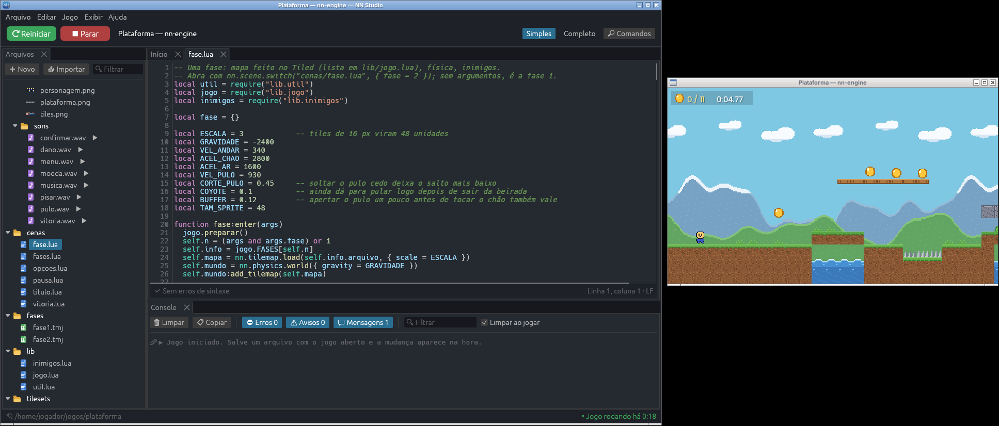

## Abrindo

- **Versão pronta:** baixe na página da
  [última versão](https://github.com/nereuneto/nn-engine/releases/latest)
  (veja [Baixar](../README.md#baixar)):
  - **Windows:** o instalador `NN-Studio-<versão>-setup.exe` (não pede
    administrador; cria o atalho no menu Iniciar) ou o `.zip` portátil.
  - **Linux:** o `.AppImage` (marque como executável e abra) ou o `.tar.gz`.

  O `nn` e o `nn-jogo` vêm junto; o `nn-jogo` é usado para exportar os
  jogos. O NN Studio avisa na tela inicial quando sai uma versão nova
  (**Avisar versões novas**, para desligar).
- **A partir do código:** `cargo studio` (precisa do Rust 1.95 ou mais novo).
  Para abrir direto um projeto: `cargo studio jogos/plataforma`.

## Gerenciador de projetos

É a primeira tela.

- **Projetos recentes:** clique para abrir. O ✖ só tira da lista (não apaga
  nada). Pastas que sumiram aparecem como "pasta não encontrada".
- **✨ Novo projeto:** escolha o nome do jogo, onde criar e o modelo (cada
  cartão mostra uma imagem do jogo que ele cria; clique duas vezes para criar
  na hora):
  - **Em código:** um jogo pequeno e completo escrito em Lua (título com
    menu, partida, pausa, fim e recorde salvo). O melhor jeito de começar pelo
    código.
  - **Plataforma:** uma fase montada no editor, **sem nenhuma linha de
    código**: tela de título com botões, herói, plataformas (uma delas
    móvel), moedas (um prefab), inimigo, abismo, HUD com corações, pausa com
    Esc, opções de volume, poeira e brilho de partículas e uma saída que só
    abre depois de pegar todas as moedas (um evento).
  - **Aventura:** visto de cima, sem código: pegue a chave, abra a porta e ache
    o tesouro, fugindo das lesmas e dos morcegos. A porta e o baú funcionam
    com eventos.
  - **Nave:** sem código: tiros, asteroides que vêm de um gerador,
    explosões de partículas, pontos, vidas e recorde salvo no computador.
  - **3D:** a ilha das estrelas montada no editor, sem código: herói em
    terceira pessoa (Jogador 3D), caixotes que caem, plataformas e um
    elevador que andam, moedas e estrelas (prefabs), placar e um evento de
    vitória.
  - **Vale 3D:** um vale pintado num [Terreno](#terreno), sem código:
    morros, um lago, uma trilha de moedas, árvores espalhadas, estrelas nos
    morros e uma fogueira.
  - **3D em código:** a mesma ilha escrita em Lua, com menu, pausa e recorde.
  - **Vazio:** uma cena vazia e um pacote de imagens e sons, para montar do
    seu jeito (o tutorial começa daqui).
  - **Vazio 3D:** um mundo 3D com chão e um pacote de modelos e sons (o
    tutorial 3D começa daqui).
  - **Mínimo:** só uma cena com um quadrado que anda.

  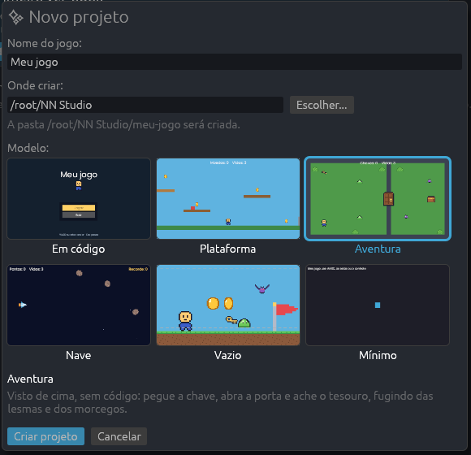
- **🎓 Tutoriais:** veja [Tutoriais](#tutoriais).
- **Primeira vez:** sem nenhum projeto ainda, a tela de boas-vindas mostra
  três jeitos de começar: **Fazer o tutorial** (*Seu primeiro jogo*),
  **Abrir um jogo pronto** (o modelo Plataforma) e **Começar do zero** (o
  modelo Vazio).
- **📂 Abrir projeto:** escolha a pasta do jogo (a que tem o `config.lua` ou o
  `main.lua`). Também dá para **arrastar a pasta** para a janela.
- **🎮 Exemplos:** abre uma cópia do jogo de plataforma ou da demonstração,
  para mexer à vontade sem estragar o original.

## Tutoriais

Um tutorial cria um projeto novo (na pasta de projetos) e abre uma janelinha
que mostra um passo de cada vez. O NN Studio **destaca** o painel ou botão de
cada passo e **avança sozinho** quando você faz o que o passo pede: ele confere
o projeto (se o chão tem corpo físico, se o herói tem o Jogador de plataforma,
se a regra existe...). Dá para voltar, pular e sair a qualquer momento; o
projeto continua aberto.

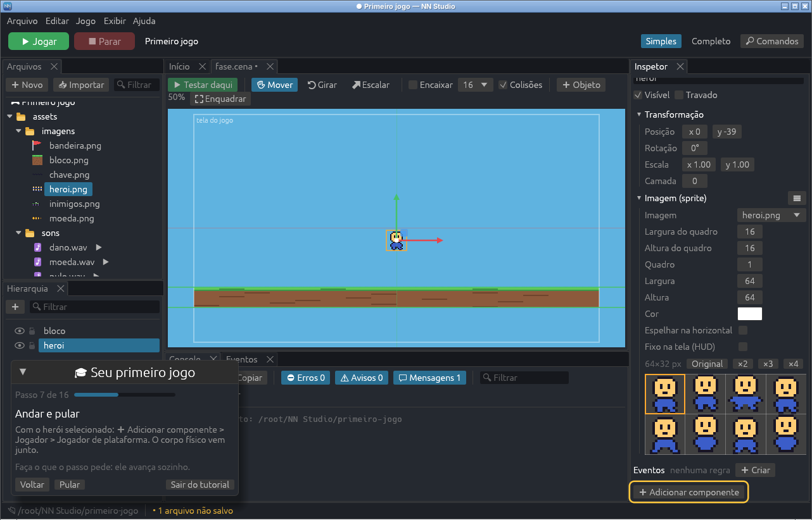

- **Seu primeiro jogo** (uns 15 minutos), a partir do modelo Vazio: chão com
  corpo físico, herói que anda e pula, animação, moedas (e um prefab delas),
  placar no HUD e um evento para vencer.
- **Seu primeiro mundo 3D** (uns 15 minutos), a partir do modelo Vazio 3D:
  um herói animado que anda e pula com a câmera atrás dele, árvores que
  bloqueiam, uma caixa que cai, um bicho que anda (Animação 3D), uma estrela,
  uma plataforma que anda, o sol da tarde e um evento de vitória
  ([cenas 3D](#cenas-3d)).
- **Efeitos no 3D** (uns 10 minutos), a partir do modelo Vazio 3D: uma
  fogueira com fogo, fumaça e o som estalando (mais alto de perto), poeira
  nos pés do herói ao pular (um evento com a mensagem *pulou*) e chuva
  ([som e partículas no 3D](#som-e-partículas-no-3d)).
- **Pinte um terreno** (uns 12 minutos), a partir do modelo Vazio 3D: um
  morro, um buraco que vira lago com água, cores de pedra e areia, árvores
  espalhadas com o pincel e um herói para passear ([terreno](#terreno)).
- **Inimigos no 3D** (uns 12 minutos), a partir do modelo Vazio 3D: um
  herói com vida e corações na tela, um besouro que persegue e machuca
  (e morre se você pular em cima), uma barra de vida e uma poça de lava
  ([inimigos no 3D](#inimigos-vida-e-dano-no-3d)).
- **Portas e chaves** (uns 10 minutos), a partir do modelo Vazio 3D: uma
  porta que abre com E, trancada até o herói achar a chave, os itens na
  tela, uma placa de Texto 3D e uma zona que fecha a porta atrás de você
  ([portas, chaves e zonas](#portas-chaves-e-zonas)).
- **Uma conversa** (uns 12 minutos), a partir do modelo Vazio 3D: uma
  conversa com falas, escolhas e um personagem novo no editor de conversa,
  um personagem que fala na cena e um evento para a escolha do jogador
  ([editor de conversa](#editor-de-conversa)).
- **Eventos** (uns 10 minutos), com o modelo Aventura: ler as regras da porta,
  testar e criar regras suas com *Quando* e *Enquanto*.
- **Desenhe seu herói** (uns 10 minutos), a partir do modelo Vazio: desenhar
  um personagem no [editor de pixel art](#editor-de-pixel-art), fazer um
  segundo quadro, animar e pôr na cena.
- **Monte uma fase com tiles** (uns 12 minutos), a partir do modelo Vazio:
  pintar o chão com um terreno que se encaixa sozinho, uma plataforma, uma
  camada de enfeites, lava animada marcada com um tipo e o evento que faz a
  lava queimar ([mapas de tiles](#mapas-de-tiles)).
- **Monte um menu** (uns 10 minutos), a partir do modelo Vazio: corações no
  HUD presos no canto da tela, uma cena de pausa que abre por cima do jogo
  com Esc, com botões e um volume ([interface](#interface-menus-e-hud)).
- **Efeitos com partículas** (uns 6 minutos), a partir do modelo Vazio: fogo
  e explosão prontos, a direção na seta, a explosão num prefab e um evento
  que solta ela com uma tecla ([partículas](#partículas)).

Eles ficam no Início (**🎓 Tutoriais**) e em **Ajuda > Tutoriais**.

## A janela do projeto

Os painéis podem ser arrastados pelas abas e encaixados onde você quiser. O
layout e as abas abertas ficam guardados para cada projeto; para voltar ao
original, use **Exibir > Restaurar layout padrão**.

- **Arquivos** (à esquerda, em cima): a pasta do projeto.
- **Hierarquia** (à esquerda, embaixo): os objetos da cena visual aberta.
- **Eventos** (embaixo, ao lado do Console): as regras "Quando... Então..."
  da cena aberta (**Exibir > Mostrar Eventos**).
- **Início, cenas, código, imagens, sons e mapas** (no centro).
- **Inspetor** (à direita): as propriedades do objeto selecionado.
- **Console** (embaixo): mensagens do jogo e do editor.

### Modo Simples e modo Completo

No alto, à direita. O **Simples** mostra só o essencial; o **Completo** mostra
todas as opções (mais configurações do projeto, detalhes internos da engine no
console, pastas de saída como `dist`, abrir no editor externo...).

### Paleta de comandos

**Ctrl+Shift+P** abre uma busca com todos os comandos e arquivos: digite parte
do nome ("export", "config", "tema", "fase1") e aperte Enter. **Ctrl+P** busca
só arquivos. A busca ignora acentos e aceita letras soltas ("cfg" acha
"Configurações").

## Arquivos

- **Clique** num arquivo para abrir. Imagens mostram uma miniatura na lista;
  sons têm um ▶ para ouvir.
- **➕ Novo:** cena visual (montada com o mouse, veja abaixo), cena em código
  (já vem com um quadrado que anda), **imagem** (para desenhar no
  [editor de pixel art](#editor-de-pixel-art): escolha o tamanho e quantos
  quadros), script (módulo para usar com `require`) ou pasta. Cenas novas vão
  para `cenas/`, imagens para `assets/imagens` e scripts para `lib/`, se
  essas pastas existirem.
- **Arraste** uma imagem, um mapa, um som ou um prefab do painel para dentro
  de uma cena visual (vira um objeto) ou para um campo de arquivo do Inspetor.
  Arraste um objeto da Hierarquia para uma pasta para criar um
  [prefab](#prefabs).
- **📥 Importar** ou **arrastar arquivos** do computador para a janela:
  imagens vão para `assets/imagens`, sons para `assets/sons` e fontes para
  `assets/fontes`. Com uma pasta selecionada no painel, vão para ela. Nada é
  sobrescrito: um arquivo com o mesmo nome vira "nome (2).png".
- **Botão direito** num arquivo:
  - **Copiar caminho**: copia `"assets/imagens/heroi.png"`, pronto para colar
    no código;
  - **Copiar require** (em scripts): copia `require("lib.util")`;
  - **Renomear** (F2), **Mandar para a lixeira** (Del), **Mostrar na pasta do
    sistema**, **Abrir no programa padrão**.
- A lista se atualiza sozinha quando algo muda na pasta (por exemplo, ao salvar
  um mapa no Tiled).

## Editor de código

- Cores para o Lua, números de linha, a linha do cursor destacada.
- **Erros de sintaxe enquanto você digita**: a linha com erro fica vermelha e a
  mensagem, em português, aparece embaixo. Clique nela para ir até a linha.
- **Recuo automático:** Enter mantém o recuo e soma um nível depois de `then`,
  `do`, `function(...)`, `{`... Tab e Shift+Tab recuam as linhas selecionadas.
- **Autocompletar:** ao digitar `nn.`, `self.`, `obj.`, `self.obj.`,
  `self.objects.`, `nn.vars.` (e outros), aparece a lista do que existe ali,
  com a descrição de cada item. **Ctrl+Espaço** abre a lista a qualquer
  momento; setas escolhem, **Enter** ou **Tab** completam, **Esc** fecha.
  A lista conhece os objetos das cenas que usam o script, as variáveis do
  jogo e, dentro de aspas, os arquivos do projeto (`"assets/imagens/...`).
- Ao abrir parênteses de uma função (`nn.draw.rect(`), os parâmetros aparecem
  acima do cursor; passar o mouse sobre um nome mostra a descrição.
- **Ctrl+/** comenta ou descomenta as linhas.
- **Ctrl+F** busca (Enter vai para a próxima, Shift+Enter para a anterior;
  "Aa" diferencia maiúsculas). **Ctrl+H** substitui. **Ctrl+G** vai para uma
  linha.
- **Ctrl+S** salva; **Ctrl+Shift+S** salva tudo. Abas com alterações mostram
  "•" no nome. Ao fechar uma aba, o projeto ou o NN Studio com alterações não
  salvas, ele pergunta antes.
- Se o arquivo mudar fora do NN Studio (em outro editor, por exemplo), ele é
  recarregado sozinho; se você também tiver alterações, ele pergunta qual
  versão manter.

## Cenas visuais

Uma cena visual (arquivo `.cena`) é montada com o mouse: você põe objetos,
arruma no lugar, ajusta as propriedades, dá a eles **comportamentos prontos**
(andar e pular, patrulhar, ser coletado, machucar, levar para outra fase...)
e junta tudo com **eventos** ("Quando o jogador encostar na chave, então...").
Sem escrever código. Ela roda na
engine como qualquer outra cena (`nn.scene.switch("cenas/fase.cena")`, cena
inicial no `config.lua`, exportação, recarregar ao salvar). Crie uma com
**Ctrl+N** ou **➕ Novo > Cena visual**.

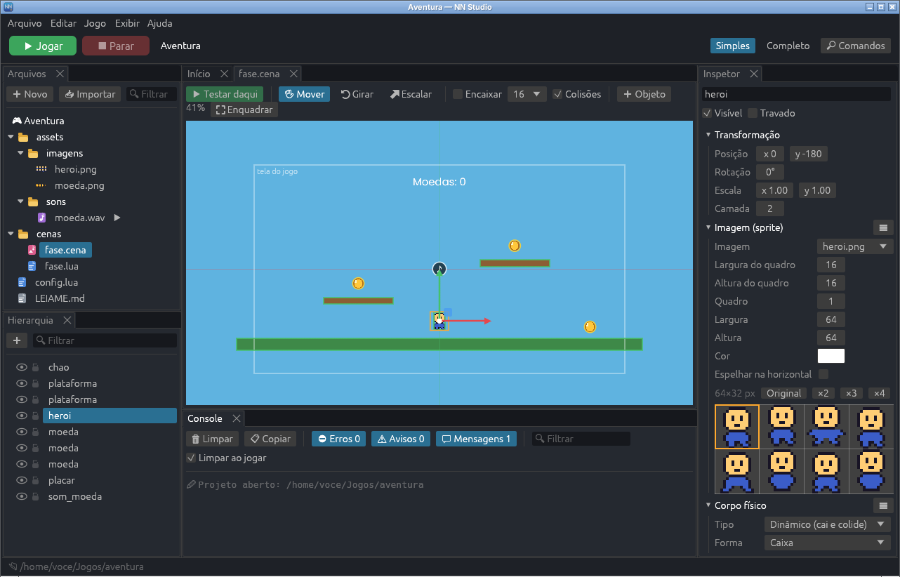

### A aba da cena

A cena é desenhada pela própria engine, do jeito que vai aparecer no jogo. O
retângulo "tela do jogo" mostra o que cabe na janela (o tamanho do
`config.lua`), a partir da posição da câmera.

- **Navegar:** role o mouse para o zoom (no ponto do cursor); arraste com o
  botão do meio, com o direito ou com **Espaço** segurado para mover a vista.
  **F** (ou ⛶ Enquadrar) enquadra o selecionado ou a cena toda.
- **Selecionar:** clique num objeto; **Shift** ou **Ctrl** somam à seleção;
  arraste num espaço vazio para selecionar com um retângulo. **Esc** limpa.
- **Ferramentas:** **W** mover, **E** girar, **R** escalar. Arraste o objeto ou
  as alças: as setas vermelha e verde movem só em X ou em Y; o círculo gira
  (com **Ctrl**, de 15 em 15 graus); os cantos escalam (com **Shift**,
  proporcional).
- **Encaixar** prende na grade ao mover (segurar **Ctrl** também encaixa). As
  **setas do teclado** movem o selecionado 1 unidade (10 com **Shift**).
- **Ctrl+D** duplica, **Del** apaga. **➕ Objeto** cria um objeto vazio, uma
  imagem, um retângulo, um círculo, um texto, uma câmera, um som,
  [partículas](#partículas) (vazias ou um efeito pronto) ou um componente de
  [interface](#interface-menus-e-hud) no meio da vista.
- **Arrastar arquivos** do painel Arquivos para a cena: uma imagem vira um
  sprite, um mapa `.tmj` vira um mapa, um som vira um objeto de som e um
  `.prefab` vira uma instância do prefab.
- **Colisões** mostra os corpos físicos (verde) por cima.

### Hierarquia

A lista dos objetos da cena, na ordem de desenho. Clique para selecionar,
clique duas vezes (ou **F2**) para renomear. O 👁 esconde e o cadeado trava (um
objeto travado não é selecionado clicando na cena). **Arraste** um objeto para
mudar a ordem ou solte em cima de outro para virar filho dele: o filho anda,
gira e escala junto com o pai. O botão direito tem Duplicar, Criar filho
vazio, Tirar do pai, **📦 Criar prefab** e Excluir; o campo 🔍 filtra pelo
nome. Instâncias de prefab aparecem em azul.

### Inspetor

Sem nada selecionado, mostra a cena: o **script** dela, a cor de **fundo**, a
**gravidade** e **Por cima** (a cena abre por cima de outra, como uma pausa:
veja [Interface](#interface-menus-e-hud)). Com um objeto selecionado, mostra o nome, visível/travado, a
**Transformação** (posição, rotação em graus, escala e camada: camada maior é
desenhada por cima) e os **componentes**:

| Componente | O que faz |
|---|---|
| Imagem (sprite) | Mostra uma imagem ou um quadro de uma spritesheet. Com **É uma tira de quadros**, escolha o quadro clicando na grade. **Animação** toca uma das [animações](#animações) da imagem (escolha no ☰), já na cena do editor. **Preencher: Repetir** repete a imagem lado a lado em vez de esticar: com escala 20, um bloco vira 20 blocos (chão, paredes, fundos). **🎨 Editar imagem** abre o [editor de pixel art](#editor-de-pixel-art); sem imagem, **🎨 Desenhar uma imagem nova** cria uma e já põe no objeto. |
| Texto | Escreve um texto no mundo. |
| Forma | Retângulo ou círculo de uma cor. |
| Corpo físico | Cai, colide, para no chão (dinâmico, estático ou cinemático; caixa ou círculo; sensor; plataforma de mão única). |
| Mapa de tiles | Desenha um mapa `.tmj`, com a colisão dos tiles. **✏ Pintar** pinta o mapa ali na cena ([mapas de tiles](#mapas-de-tiles)); **Abrir o mapa** abre a aba dele. |
| Câmera | Onde a câmera começa, ou quem ela segue (com suavidade e limite no mapa). |
| Som | Toca um som ou música quando a cena começa. |
| Partículas | Fogo, fumaça, faíscas, explosões, chuva... animando na cena ([partículas](#partículas)). |
| Interface | Painel, Botão, Barra, Ícones, Deslizador, Caixa de marcar, Campo de texto e Grupo: menus e HUD ([interface](#interface-menus-e-hud)). |
| Comportamento | Um comportamento pronto ou um script seu (veja abaixo). |

**➕ Adicionar componente** acrescenta outro; o menu ☰ de cada um sobe, desce
ou remove. Campos de arquivo aceitam arrastar do painel Arquivos. No modo
Simples, opções avançadas ficam escondidas.

Imagem, texto e forma têm a opção **HUD**: o objeto fica **fixo na tela**
(placar, vidas, botões), em vez de andar com o mundo. Na cena, ele aparece
dentro do retângulo da tela do jogo. A posição conta a partir do ponto da
tela escolhido em **Transformação > Preso em** (o centro, se você não
escolher): preso no canto de cima à esquerda, ele continua no canto em
qualquer tamanho de janela. Os componentes de interface já vêm fixos na tela.

### Comportamentos (sem código)

Um comportamento é uma peça pronta de lógica que você põe num objeto pelo
Inspetor: **➕ Adicionar componente** mostra os comportamentos por categoria.
Cada um tem suas propriedades (velocidade, altura do pulo, quantas vidas...),
com explicação ao passar o mouse.

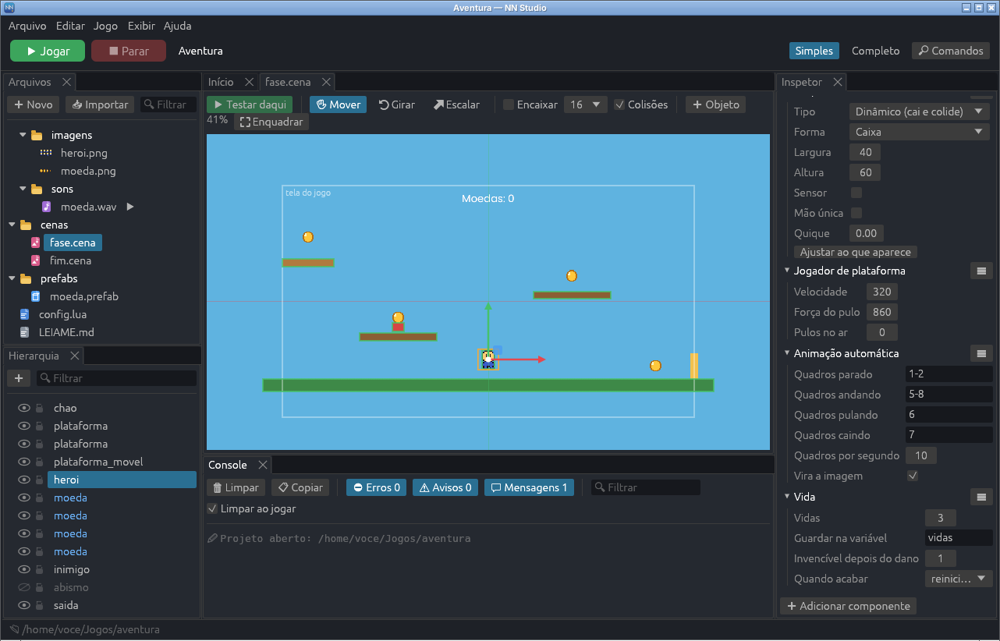

| Categoria | Comportamento | O que faz |
|---|---|---|
| Jogador | Jogador de plataforma | Anda para os lados e pula (setas, WASD, espaço ou controle), com tolerância na beirada e pulo mais alto segurando. Pede um corpo físico. |
| Jogador | Jogador top-down | Anda em todas as direções (jogo visto de cima). |
| Jogador | Vida | Pontos de vida. Quando acabam: reinicia a cena, volta ao checkpoint, vai para outra cena ou o objeto some. |
| Inimigos | Patrulha | Anda até bater numa parede (ou chegar na beirada) e volta. |
| Inimigos | Perseguir | Vai atrás do jogador (ou de outro objeto) quando ele chega perto; andando ou voando. |
| Inimigos | Perigo | Espinho, lava, inimigo: tira vida, manda de volta ao checkpoint ou reinicia. Com **Pisar derrota**, pular em cima destrói o inimigo. |
| Itens | Coletável | Some quando o jogador encosta e soma numa variável do jogo (com som e brilho). |
| Fases | Checkpoint | Ao passar, o jogador volta para cá quando perder. |
| Fases | Ir para cena | Porta, saída, bandeira: leva para outra cena (ao encostar ou apertando uma tecla). |
| Movimento | Movimento automático | Gira, flutua ou vai e volta sozinho (plataformas móveis, enfeites). |
| Aparência | Animação automática | Troca a animação quando o objeto está parado, andando, pulando ou caindo. Em cada estado, escolha uma das [animações](#animações) da imagem no ☰ (ou escreva quadros: `1-4`, `5,6`...). |
| Aparência | Mostrar valor | Mostra variáveis do jogo num texto: `Moedas: {moedas}`. |
| Ações | Atirar | Cria um tiro (um prefab) ao apertar uma tecla ou sozinho, de tempos em tempos. |
| Ações | Gerador | Cria objetos (um prefab) de tempos em tempos. |
| Ações | Destruir depois | Some depois de um tempo ou ao sair da tela. |
| Interface | Botão | Para menus: destaca ao passar o mouse (ou com as setas) e, ao clicar ou apertar Enter, vai para uma cena, reinicia ou fecha o jogo (ou deixa um evento decidir). |

"Quem" e "Alvo", quando ficam vazios, querem dizer **o jogador** (o objeto com
um comportamento de jogador). Se um comportamento precisa de algo que o objeto
não tem (um corpo físico, uma imagem), o Inspetor avisa e oferece adicionar; ao
escolher um comportamento que precisa de corpo, ele já vem junto.

**Seus próprios comportamentos:** **➕ Adicionar componente > Script do jogo >
Novo script...** cria `scripts/<nome>.lua` com um modelo comentado e já põe no
objeto. As propriedades declaradas no script (`props`) aparecem no Inspetor do
mesmo jeito que as dos prontos, e cada objeto pode ter valores diferentes. O
formato está no [guia do Lua](lua.md#comportamentos).

### Prefabs

Um prefab (arquivo `.prefab`) é um objeto pronto para usar várias vezes, em
várias cenas: uma moeda, um inimigo, um tiro.

- **Criar:** botão direito no objeto da Hierarquia > **📦 Criar prefab** (vai
  para `prefabs/`), ou arraste o objeto para uma pasta do painel Arquivos.
  O objeto vira uma instância do prefab novo.
- **Usar:** arraste o `.prefab` do painel Arquivos para a cena.
- **Editar:** clique no `.prefab` no painel Arquivos (ou **Abrir prefab** no
  Inspetor). Ele abre numa aba como uma cena; ao salvar, **todas as
  instâncias** mudam, em todas as cenas.
- **Mudar só uma instância:** mude a posição, o nome ou qualquer propriedade
  do objeto principal no Inspetor. O que for diferente do prefab fica em
  **negrito**, com um ↺ para voltar ao valor do prefab. Os filhos do prefab
  seguem sempre o prefab.
- **Desvincular** (no Inspetor) transforma a instância num objeto comum, com
  uma cópia de tudo.
- No jogo, `scene:spawn("prefabs/tiro.prefab", x, y)` cria um na hora (é o que
  Atirar e Gerador fazem).

### Variáveis do jogo e HUD

As **variáveis do jogo** guardam o que vale para o jogo todo: moedas, vidas,
pontos, chaves. Elas são criadas em **Configurações do projeto > Variáveis do
jogo** (ficam no `config.lua`, em `vars`) e:

- passam de uma cena para outra e voltam ao valor inicial quando o jogo
  reinicia (ou quando a Vida acaba e a cena reinicia);
- são usadas pelos comportamentos: Coletável soma, Vida mostra as vidas que
  restam, Mostrar valor escreve no texto;
- no código, ficam em `nn.vars` (`nn.vars.moedas = nn.vars.moedas + 1`).

Para um placar: um objeto de texto com **HUD** marcado e o comportamento
**Mostrar valor** com `Moedas: {moedas}  Vidas: {vidas}`. Para as vidas, o
componente **Ícones** com a variável `vidas` mostra um coração para cada uma;
a **Barra** mostra uma variável enchendo (vida, energia, tempo). Veja
[Interface](#interface-menus-e-hud).

### Interface: menus e HUD

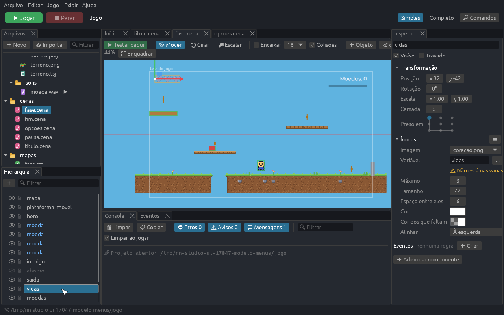

**➕ Objeto > Interface** (e **➕ Adicionar componente > Interface**) traz os
componentes de menu e HUD:

| Componente | O que faz |
|---|---|
| Painel | Fundo de menu ou de HUD: cor, cantos arredondados e borda, ou uma **imagem** de moldura em 9 fatias (os cantos não esticam, o meio estica). |
| Botão | Texto (e ícone) num painel que muda de cor com o foco e ao apertar. **Ao apertar**: trocar de cena, abrir uma cena **por cima**, fechar esta cena, reiniciar ou sair do jogo; para outras coisas, a condição **Clique no objeto** nos eventos. **Começa com foco** escolhe o primeiro botão para quem joga com teclado ou controle. |
| Barra | Mostra uma variável do jogo enchendo, até um máximo (ou outra variável, como a vida máxima). Enche para a direita, a esquerda, cima ou baixo. |
| Ícones | Uma imagem para cada ponto de uma variável: corações para as vidas. Com **Máximo**, os que faltam aparecem apagados. |
| Deslizador | Escolhe um valor arrastando ou com as setas: uma variável, ou o **volume** da música, dos efeitos ou geral. |
| Caixa de marcar | Liga e desliga uma variável, ou a **tela cheia**. |
| Campo de texto | Para digitar (o nome do jogador): o texto vai para uma variável. |
| Grupo (arrumar) | Arruma os filhos sozinho, em coluna, em linha ou em grade, com um espaço entre eles. Opcional: sem ele, cada objeto fica onde você puser. |

**➕ Objeto > Interface > Menu com botões** faz um menu pronto: um painel com
um Grupo e três botões (Jogar, Opções e Sair).

Os menus funcionam **sem código** com o mouse, com as setas (ou WASD) e Enter
ou espaço, e com o controle (direcional e A). O foco anda para o item mais
perto na direção apertada; Tab vai para o próximo. Num deslizador com foco, a
esquerda e a direita mudam o valor. Os volumes e a tela cheia escolhidos ficam
guardados e valem da próxima vez que o jogo abrir. Quando um valor muda, a
condição **Mudar de valor** dispara nos eventos.

**Cenas por cima.** Uma cena com **Por cima** marcado (no Inspetor da cena, ou
**Abre por cima de outra cena** ao criar uma cena visual nova) abre por cima
da que está rodando: a de baixo continua aparecendo, **parada**, e o fundo da
cena por cima vira um véu (use uma cor transparente). Abra com a ação
**Abrir cena por cima** (por exemplo, quando apertar a tecla *voltar*, que é
Esc ou o B do controle) ou com um botão; feche com **Fechar esta cena** ou um
botão **Fechar**. Uma cena por cima pode abrir outra (as opções por cima da
pausa).

**Tema da interface.** As cores vazias dos componentes (marcadas **do tema**
no Inspetor) vêm do tema do projeto, em **Configurações do projeto > Tema da
interface**: texto, botão (normal, com foco, apertado e desligado), painel,
bordas e destaque, além da **fonte** (um `.ttf` ou `.otf` do projeto) e do
**som** dos botões. Mude o tema e todos os menus mudam juntos; escolher uma
cor no Inspetor muda só aquele componente (**↺ tema** volta). O componente
Texto também tem **Fonte**.

**Telas de outros formatos.** O **📐** na barra da cena mostra a tela do jogo
em outras proporções (16:9, 4:3, 21:9, celular em pé), para conferir se o HUD
preso nos cantos fica no lugar.

### Eventos: "Quando... Então..."

Os comportamentos fazem cada objeto funcionar; os **eventos** são as regras do
seu jogo: *quando* o jogador pegar todas as moedas, *então* a saída abre;
*quando* a vida acabar, *então* guarde o recorde e vá para a tela de fim. Ficam
no painel **Eventos** (embaixo, ao lado do Console), uma regra por cartão,
lidas como frases, com os campos no meio da frase.

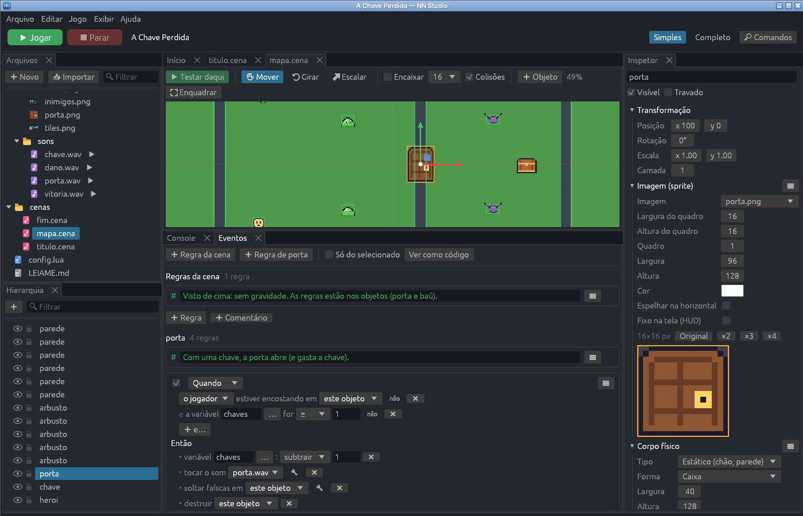

- **➕ Regra da cena** cria uma regra que vale para a cena toda. Com um objeto
  selecionado, **➕ Regra de <objeto>** cria uma regra **do objeto**: ela vai
  junto com ele (e com todas as cópias, se ele for um prefab). Na regra de um
  objeto, *este objeto* é ele mesmo.
- O menu de cada **➕** tem as condições ou ações por categoria e uma busca
  (digite e aperte Enter para a primeira).
- Uma regra pode ter várias condições (**e**: todas precisam valer) e várias
  ações (feitas em ordem). O **não** no fim da linha inverte uma condição.
- **Quando** acontece uma vez, no momento em que as condições passam a valer
  (ou a cada vez que um gatilho, como "apertar uma tecla", acontece).
  **Enquanto** acontece a cada quadro, enquanto tudo vale.
- **O outro** é com quem a condição aconteceu: em quem o jogador encostou, o
  item que ele pegou. Ex.: *Quando o jogador encostar em chave, então destruir
  o outro*.
- **Esperar N segundos** atrasa as ações seguintes da regra.
- O ☑ desliga a regra sem apagar; o ☰ duplica, sobe, desce, põe um
  **comentário** acima ou exclui. Desfazer e refazer valem para tudo.
- Nomes de objetos, variáveis ou arquivos que não existem ficam com um
  contorno amarelo e a explicação ao passar o mouse.
- **Ver como código** mostra o Lua que faz o mesmo que as regras (só para ler
  e aprender: o jogo usa as regras).

| Condições (Quando) | |
|---|---|
| Cena e tempo | começar, a cada N segundos, depois de N segundos, sorte (chance em %) |
| Controles | apertar, soltar ou estar segurando uma tecla (ou um grupo: pular, confirmar, voltar, setas...), clicar num objeto |
| Toques | encostar em, parar de encostar, estar encostando, estar perto de, encostar num tile (de um tipo) |
| Variáveis | comparar uma variável do jogo (=, ≠, <, >, ≤, ≥) |
| Objetos | não sobrar nenhum (com um nome), ser destruído, sair da tela, estar no chão ou no ar, estar visível ou escondido |
| Mensagens | pegar um coletável, levar dano, a vida acabar, receber uma mensagem |

| Ações (Então) | |
|---|---|
| Variáveis | mudar (somar, subtrair, mudar para, ficar com o maior/menor), salvar no disco, carregar do disco, zerar todas |
| Cenas | ir para outra cena, reiniciar (do começo ou do checkpoint), fechar o jogo |
| Objetos | criar um prefab, destruir, mostrar ou esconder |
| Movimento | levar para uma posição, mudar a velocidade ou empurrar |
| Aparência | mudar texto (com `{variavel}`), imagem, quadro ou cor, soltar faíscas, tremer a câmera |
| Som | tocar um som, tocar ou parar a música |
| Comportamentos | ligar ou desligar um comportamento, mandar uma mensagem |
| Tempo | esperar, escrever no console |
| Mapas | trocar o tile tocado, trocar o tile em um objeto (0 apaga; a colisão acompanha) |

Algumas ações têm opções a mais no 🔧 (deslocamento ao criar, volume, força do
tremor...). O formato no arquivo está no
[guia do Lua](lua.md#eventos-quando-então).

### Partículas

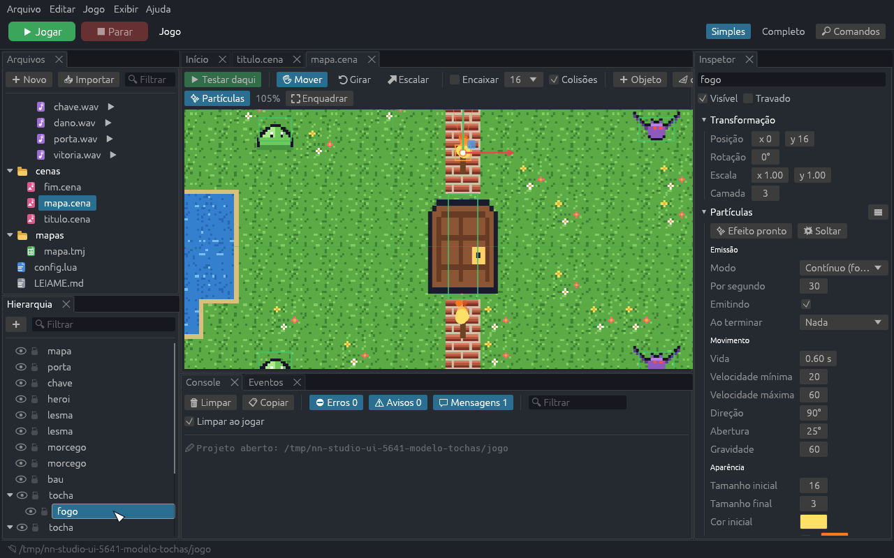

**➕ Objeto > Partículas** cria um emissor vazio ou um **efeito pronto**:
fogo, fumaça, faíscas, explosão, poeira, brilho, bolhas, chuva, neve e
confete. No Inspetor, **✨ Efeito pronto** troca os valores pelos de outro
efeito (Ctrl+Z desfaz).

As partículas **animam na cena do editor**, como no jogo. O botão **✨
Partículas**, na barra da cena, pausa a prévia. Com o objeto selecionado, a
**seta laranja** mostra a direção e a abertura (arraste a ponta para mudar a
direção; com Ctrl, de 15 em 15 graus), e a área onde as partículas nascem
aparece tracejada.

O componente tem três grupos:

- **Emissão.** *Contínuo* solta sem parar (por segundo); *De uma vez* solta
  uma quantidade junta, ao começar (*Soltar ao começar*), repetindo (*Repetir
  a cada*) ou só quando um evento pedir. *Ao terminar: destruir o objeto*
  faz o objeto sumir quando todas as partículas acabam. A área onde nascem
  pode ser um ponto, um retângulo (chuva e neve no alto da tela) ou um
  círculo.
- **Movimento.** Vida (com variação), velocidade, direção, abertura,
  gravidade (negativa cai, positiva sobe, como a fumaça), freio e
  **Acompanham o objeto** (o jato de uma nave anda junto com ela; desligado,
  vira um rastro).
- **Aparência.** Tamanho inicial e final (com variação), cores inicial,
  do meio (opcional) e final, **Luz** (soma as cores: fogo e faíscas mais
  fortes), uma **imagem** ou um quadro de spritesheet no lugar do círculo
  suave, e giro.

**💥 Soltar**, no Inspetor, solta uma leva na prévia. Uma explosão no
editor repete sozinha, para dar para ver.

**Efeitos em prefab.** Um efeito que aparece quando algo acontece (uma
explosão, um brilho ao pegar uma moeda) fica bem num [prefab](#prefabs): um
objeto com Partículas *De uma vez* e *Ao terminar: destruir o objeto*. A
ação **Criar prefab** dos eventos põe ele onde precisa; ele estoura e some.

Nos [eventos](#eventos-quando-então): a ação **Soltar partículas** solta uma
quantidade de um objeto (poeira ao pular), **Ligar ou desligar partículas**
para ou volta a emissão contínua, e a condição **Partículas terminarem** avisa
quando uma explosão acabou.

Os modelos têm exemplos: na **Nave**, o jato atrás da nave e a explosão dos
asteroides (`prefabs/explosao.prefab`); na **Plataforma**, poeira ao pular e
um brilho ao pegar moeda; na **Aventura**, tochas com fogo.

### Desfazer e salvar

**Ctrl+Z** desfaz e **Ctrl+Y** (ou Ctrl+Shift+Z) refaz o que foi feito na cena,
na Hierarquia ou no Inspetor; arrastar com o mouse conta como um passo só.
**Ctrl+S** salva o `.cena`. A aba mostra "•" enquanto houver alterações.

O `.cena` é um arquivo Lua comum e legível (veja o formato no
[guia do Lua](lua.md#cenas-visuais-cena)). Dá para editá-lo à mão: se ele mudar
fora do editor, a aba recarrega sozinha.

### Testar daqui e ajuste ao vivo

**▶ Testar daqui (F6)** salva tudo e roda o jogo começando nesta cena, em vez
da cena inicial do projeto.

Com o jogo aberto mostrando a cena, aparece **• Ao vivo** na barra da cena: o
que você mudar no Inspetor ou arrastando na cena aparece no jogo **na hora,
sem salvar**. Para guardar a mudança, salve; para descartar, desfaça.

E o caminho de volta, do jogo para o editor:

- **Fantasmas:** onde um objeto está agora no jogo (se andou para longe do
  lugar onde você o pôs), a cena mostra o contorno tracejado dele.
- **No jogo:** no Inspetor, a posição atual do objeto no jogo e os valores dos
  comportamentos que mudaram (as vidas que restam, por exemplo) aparecem em
  ciano. **Manter** traz o valor para a cena (e dá para desfazer). Sem nada
  selecionado, o Inspetor mostra as variáveis do jogo agora.
- **Pausar / Continuar / Avançar 1 quadro**, na barra da cena, congelam o
  jogo para olhar com calma.
- **Ctrl+clique** num objeto, na janela do jogo, seleciona ele no editor.
- **Eventos ao vivo:** o que você muda nas regras também vale na hora, e cada
  regra **acende** no painel Eventos quando dispara no jogo. Ótimo para
  entender por que algo aconteceu (ou não).

### O script da cena

Para regras que nenhum comportamento cobre, a cena pode ter um script Lua (no
Inspetor, **Script > Criar**). Ele recebe os mesmos callbacks de uma cena em
código (`enter`, `fixed_update`, `update`,
`draw`...) e encontra os objetos em `self.objects`, pelo nome:

```lua
local cena = {}

function cena:fixed_update(dt)
  local heroi = self.objects.heroi
  heroi.body.vx = nn.input.move() * 300
end

-- Dois corpos se tocaram.
function cena:contact(e)
  if e.object_a.name == "moeda" then e.object_a:destroy() end
end

return cena
```

A referência completa está no [guia do Lua](lua.md#cenas-visuais-cena).

## Cenas 3D

Uma cena visual também pode ser **3D**: o mesmo arquivo `.cena`, com
`mode = "3d"`, aberto numa vista em perspectiva com céu, sol, névoa e
sombras, desenhada pela engine do jeito que vai aparecer no jogo.

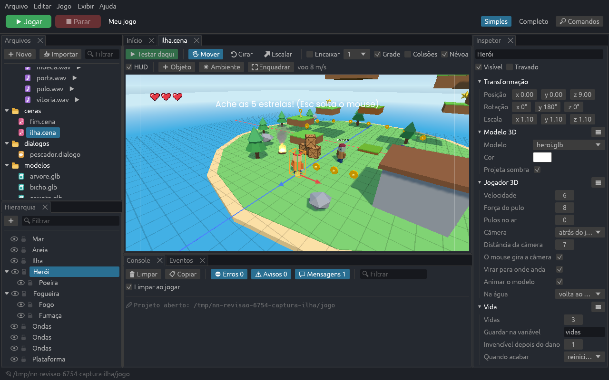

Para aprender fazendo, o tutorial guiado **Seu primeiro mundo 3D** (em
[Tutoriais](#tutoriais)) monta um mundo com herói, árvores, uma caixa que cai,
uma estrela, uma plataforma que anda e um evento de vitória. O modelo **3D**
(Novo projeto) é uma ilha inteira montada assim, sem código.

### Passo a passo: uma cena 3D do zero

1. **Ctrl+N** (ou **➕ Novo > Cena visual**), dê um nome (`mundo`) e marque
   **Tipo: 3D**. Clique em **Criar**. A cena já vem com uma **Câmera**, um
   **Chão** verde e um **Cubo** laranja.
2. **Olhe em volta:** segure o **botão direito** do mouse em cima da vista e
   mova o mouse para virar a cabeça; com o botão segurado, **W A S D** andam
   e **Q / E** descem e sobem. A rodinha, enquanto voa, muda a velocidade
   (aparece em "voo 8 m/s"). Perdeu-se? Aperte **F** (⛶ Enquadrar).
3. **Ponha coisas no mundo:** em **➕ Objeto**, escolha **Esfera**. Ela
   aparece onde a vista aponta, já selecionada. Ou arraste um modelo `.glb`
   do painel Arquivos para a vista: ele cai em cima do que estiver embaixo
   do mouse (o chão, outro objeto).
4. **Arrume:** com **W** (Mover), arraste a seta vermelha, verde ou azul para
   mover só em X, Y (altura) ou Z, ou o quadradinho do meio para deslizar no
   chão. **E** gira (os anéis) e **R** escala (os cubinhos; o do meio escala
   por igual). Marque **Encaixar** para prender na grade (1 m, ou o tamanho
   escolhido ao lado); segurar **Ctrl** faz o contrário do que estiver
   marcado. Os números exatos ficam no Inspetor, em **Transformação**.
5. **Mude o tempo:** clique em **☀ Ambiente** (ou num espaço vazio da lista
   da Hierarquia) e, no Inspetor, baixe a **altura do sol** para 15°: fim de
   tarde, sombras compridas. Troque as cores do céu, ligue ou desligue a
   névoa e as sombras. A vista muda na hora.
6. **Jogue:** **▶ Testar daqui (F6)** salva e roda a cena. O jogo mostra o
   que a **Câmera** vê: posicione ela (mover e girar, como qualquer objeto)
   para enquadrar o mundo. O cone azul na vista mostra para onde ela olha.

7. **Um herói:** **➕ Objeto > Jogador 3D** (ou arraste um modelo e adicione
   **Jogador > Jogador 3D**). No jogo, ele anda, pula e leva a câmera atrás
   dele. Para o chão segurar, o Chão já vem com um **Corpo 3D**.

### Navegar na vista 3D

| Para | Faça |
|---|---|
| Olhar em volta | Botão direito segurado + mover o mouse |
| Voar | Botão direito segurado + **W A S D**, **Q / E** (Shift: mais rápido) |
| Velocidade do voo | Rodinha, com o botão direito segurado |
| Aproximar / afastar | Rodinha |
| Girar em volta do selecionado | **Alt** + arrastar |
| Arrastar a vista | Botão do meio |
| Enquadrar o selecionado (ou tudo) | **F** ou ⛶ Enquadrar |

### Objetos 3D

- **Selecionar:** clique no objeto; **Shift** ou **Ctrl** somam à seleção.
  **Esc** limpa, **Del** apaga, **Ctrl+D** duplica, **Ctrl+Z** desfaz.
- **Forma 3D:** cubo, esfera, cilindro, cone, cápsula ou plano, com cor e
  "Projeta sombra".
- **Modelo 3D:** um arquivo `.glb` (Blender exporta: *Arquivo > Exportar >
  glTF 2.0*, formato *glb*), parado ou animado. **Cor** tinge o modelo; **Faces retas**
  (no modo Completo) dá a cada face um tom só, o visual low-poly, mesmo que
  o modelo venha com sombreado suave.
- **Câmera 3D:** de onde o jogo olha, com o **campo de visão** (60° é o
  normal; menos é zoom). Sem câmera, o jogo olha do alto, de (0, 5, 10) para o centro.
- **Texto 3D:** um texto no mundo (placas, nomes, avisos), com o tamanho das
  letras em metros, cor, contorno e fundo. **Virado para a câmera** fica
  sempre de frente; **a frente do objeto** prende como uma placa (gire o
  objeto para virar). Ele aparece atrás das paredes, como tudo do mundo.
- Hierarquia, prefabs e os componentes de **Som** funcionam como no 2D:
  arraste um objeto para dentro de outro na Hierarquia e ele passa a se mover
  junto (girar o pai gira os filhos em volta dele).
- No 3D, **X e Z** são o chão e **Y** é a altura, em metros. A rotação está
  em graus: **Y** vira para os lados, **X** inclina para a frente e para
  trás, **Z** rola.

### HUD e menus no 3D

O que fica preso à tela (placar, corações, avisos, menus) não está no mundo
3D: aparece **por cima da vista**, dentro de uma moldura com o tamanho da
tela do jogo, do jeito que fica no jogo. Clique para selecionar e arraste
para mudar o lugar (as posições são em pixels, a partir do ponto da tela em
que o objeto está preso). **HUD**, na barra da cena, mostra ou esconde.

Para criar: **➕ Objeto > Na tela (HUD)** tem **Texto na tela** e os
componentes de interface (painel, botão, barra, ícones e o menu com botões).
O mesmo menu está no **➕** da Hierarquia.

Ao abrir a cena, a vista olha para o **Jogador 3D** de perto. **⛶ Enquadrar**
(F) sem nada selecionado mostra a cena toda; de longe, a **Névoa** da vista
desliga sozinha (marque de novo para ver como fica no jogo; no jogo, a névoa
continua).

### Ambiente

| Campo | O que faz |
|---|---|
| Céu | Degradê atrás de tudo: em cima, no horizonte e embaixo. Desligado, aparece o **Fundo** |
| Sol | **Altura** (90° = meio-dia; perto de 0° = fim de tarde) e **lado** de onde vem a luz |
| Luz do sol | A cor da luz e o tamanho do disco do sol no céu |
| Luz ambiente | A luz onde o sol não bate: a que vem de cima e a que vem de baixo |
| Névoa | O que está longe some na cor do horizonte, entre as duas distâncias |
| Sombras | Sombra do sol até esta distância da câmera |

### Física: Corpo 3D

Adicione **Corpo 3D** (➕ Adicionar componente) a tudo o que deve bloquear,
cair ou empurrar. Sem ele, o objeto é só enfeite: o herói atravessa.

| Tipo | Para quê |
|---|---|
| **Parado** | Chão, paredes, árvores, casas: nunca sai do lugar. |
| **Cai e é empurrado** | Caixas, bolas, barris: cai com a gravidade da cena (a do Inspetor da cena, -20 por padrão), rola e é empurrado pelo herói. |
| **Se move sozinho** | Plataformas, elevadores, portas: o jogo move (com o comportamento **Plataforma que anda**, por exemplo) e quem está em cima vai junto. |

A **Forma automática** escolhe pelo que o objeto mostra: num corpo parado ou
que se move sozinho com um **Modelo 3D**, a **malha exata** do modelo (dá
para subir no telhado da casa); nos outros, uma caixa, esfera, cápsula ou
cilindro do tamanho do modelo ou da forma, com a escala do objeto. Dá para
escolher a forma à mão. **Só detecta (sensor)** não bloqueia: só avisa quem
entra (para zonas e portas com eventos). No modo Completo aparecem o atrito,
a massa, "não gira" e o multiplicador da gravidade.

**Colisões**, na barra da cena, mostra os corpos em verde e o Jogador 3D em
azul (no 3D, começa desligado).

### Jogador 3D

O comportamento **Jogador 3D** (**➕ Adicionar componente > Jogador**) faz o
objeto andar com **WASD**, as setas ou o analógico, para onde a câmera olha,
e pular com **espaço** ou **A** do controle. Ele não precisa de Corpo 3D: o
corpo dele é uma cápsula do tamanho do modelo, com os pés no fundo do
modelo. A frente do modelo é o **+Z** (vire o objeto em Y para ele começar
olhando para outro lado).

| Propriedade | O que faz |
|---|---|
| Velocidade, Força do pulo, Pulos no ar | Metros por segundo; 1 pulo no ar = pulo duplo. |
| Câmera | **Atrás do jogador** (3ª pessoa: não atravessa paredes, aproxima com a rodinha) ou **a Câmera 3D da cena** (fixa; o jogador anda em relação a ela). |
| Distância da câmera | Quão longe ela fica. |
| O mouse gira a câmera | O cursor some e o mouse gira a câmera. **Esc** solta o mouse; um clique na janela prende de novo. |
| Virar para onde anda | O modelo vira para a direção do movimento. |
| Volta se cair abaixo de | (Completo) Caiu do mundo: volta ao último chão firme e recebe a mensagem **caiu** (use num evento para tocar um som ou tirar uma vida). |

Ele também manda a mensagem **pulou** a cada pulo.

Com um modelo animado (como o `heroi.glb` dos modelos 3D), o Jogador 3D
**anima sozinho**: *parado*, *andar* (com o analógico pela metade),
*correr*, *pular* e *cair*, com troca suave. A vista do editor já mostra ele
respirando, parado. No modo Completo dá para trocar os nomes das animações
(para personagens com outros nomes) ou desligar **Animar o modelo**.

### Animação 3D

Modelos `.glb` com esqueleto trazem animações (no Blender, as *Actions*;
veja [o guia do Lua](lua.md#animações-personagens-com-esqueleto) para trazer
personagens do Blender e do Mixamo). Para um objeto tocar uma:
**➕ Adicionar componente > Animação 3D** e, em **Animação**, clique no ☰ e
escolha (o ☰ lista as do modelo do objeto). **Velocidade** acelera ou
desacelera; sem **Repetir**, ela toca uma vez e para no fim. A vista do
editor toca a animação na hora, para você ver como fica.

Nos eventos, **Tocar animação** troca a animação de um objeto (com
**Repetir** no modo Completo) e **Animação terminar** avisa quando uma que
toca uma vez chega ao fim. No código, `obj:play("acenar")`.

### Terreno

Um **Terreno** é um chão grande que se pinta com o mouse: morros, vales,
estradas, cores e água. **➕ Objeto > Terreno** cria um plano de 64 × 64 m;
com ele selecionado, clique em **✏ Pintar terreno** na barra da vista 3D.
Enquanto o pincel está ligado, o **botão esquerdo pinta** (em vez de
selecionar e mover), um círculo branco mostra onde e o tamanho, e o botão
direito continua voando. Cada arrasto é um passo do **Ctrl+Z**.

| Pincel | O que faz |
|---|---|
| **⬆ Subir** / **⬇ Descer** | O chão sobe (ou desce) enquanto você segura o botão. **Ctrl** faz o contrário. |
| **Alisar** | Tira os bicos e os degraus. |
| **Aplainar** | Puxa para a altura de onde você começou a arrastar: estradas, lugares para construir. |
| **Ruído** | Calombos sorteados: o chão fica menos liso. |
| **Pintar cor** | Pinta uma das quatro cores (1 a 4). As cores ficam no Inspetor: grama, terra, pedra e areia, por padrão. |
| **Espalhar** | Põe cópias de um modelo (`.glb`) ou prefab no chão, com tamanho e giro sorteados, sem amontoar (**Por segundo** diz quantas). Os modelos já vêm com **Corpo 3D**. **Ctrl** apaga as que estiverem no círculo. |

**Tamanho** é o raio do pincel em metros e **Força**, quanto muda por
segundo. No Inspetor ficam a **Largura** e o **Fundo** (mudar estica o que
foi pintado), as quatro **cores** e a **Água**: marque e ajuste o **Nível
da água**, e o que estiver abaixo vira lago ou mar (a água é meio
transparente). No modo Completo, **Detalhe** (quadrados por lado: 64 é um bom
começo) e **Altura máxima**.

O terreno é o chão da física (os mesmos triângulos do desenho): o herói sobe
os morros e as caixas rolam ladeira abaixo. O **Jogador 3D** que entra na
água recebe a mensagem **agua** e, com **Na água: volta ao chão firme**
(o padrão), volta para a margem. O terreno usa só a **posição** do objeto
(girar e escalar não mudam ele).

### Som e partículas no 3D

**Som 3D:** arraste um `.wav` (ou `.ogg`, `.mp3`) para a vista 3D, ou adicione
**Som** a um objeto. Numa cena 3D, o componente tem **Som no espaço 3D**
(ligado): o som sai do objeto, fica mais baixo longe dele e vai para o lado
em que ele está, e anda junto se o objeto andar. **Ouvido até** é a
distância em que ele some (até um quarto dela, o volume é cheio). Quem ouve
é a câmera do jogo. Desligado, o som é igual em todo lugar (música).
Fogueiras, cachoeiras, o mar e máquinas ficam bem com **Repetir**.

**Partículas 3D:** **➕ Objeto > Partículas** tem efeitos prontos do 3D, em
metros: fogo, fumaça, faíscas, explosão, poeira, brilho, chuva e neve. Eles
animam na vista enquanto você monta. As partículas saem para o **"cima"
do objeto**: gire o objeto para apontar (a poeira de lado, a água de uma
fonte). A **Abertura** é um cone em volta dessa direção, e a área (retângulo
ou círculo) fica deitada no chão: para chuva e neve, suba o objeto uns 10 m.
Elas aparecem atrás e na frente dos objetos certos e pegam a névoa.

Nos eventos, **Soltar partículas**, **Ligar ou desligar partículas**,
**Faíscas** e **Partículas terminarem** funcionam no 3D. **Tocar som** ganha
**saindo de**: o som sai do objeto escolhido (no Herói, o pulo; numa porta,
o rangido). O **Coletável** solta um brilho 3D ao ser pego.

### Inimigos, vida e dano no 3D

- **Vida** (Jogador > Vida) vale no 3D como no 2D: o herói tem vidas (na
  variável **vidas**), fica invencível e pisca um pouco depois de um dano e,
  quando elas acabam, a cena começa de novo (ou volta ao checkpoint, ou vai
  para outra cena). Num inimigo, **Quando acabar: some** e **Barra de vida em
  cima** mostram quanto falta.
- **Corações na tela:** **➕ Objeto > Na tela (HUD) > Ícones**, com a imagem
  `coracao.png` e a variável **vidas** (os modelos 3D já trazem; veja
  [HUD e menus no 3D](#hud-e-menus-no-3d)).
- **Inimigo 3D** (Inimigos): anda **indo e voltando** (até o X e o Z que
  você escolher, a partir de onde ele começa), **sem rumo** por perto ou
  fica **parado**; quando o herói chega a menos que **Vê o jogador a**,
  persegue (e desiste se ele fugir para longe). Quem encosta perde uma vida e
  é empurrado; **pular em cima** derrota o inimigo (com Vida, tira uma vida
  dele a cada pisão). Num modelo animado, como o `bicho.glb`, ele toca
  *parado* e *andar* sozinho, e preso numa parede, troca de rumo.
- **Perigo** (Inimigos): lava, espinhos, um tiro. Machuca e empurra quem
  encosta.
- **Atirar** (Ações): no 3D, o tiro (um prefab) sai da frente do objeto,
  da altura escolhida, e some sozinho depois de uns segundos. Um prefab de
  bola com **Corpo 3D** (só detecta) e **Perigo** com *Machuca* = o nome do
  inimigo derruba inimigos de longe.

### Portas, chaves e zonas

**➕ Objeto > Portas e itens** traz tudo pronto:

- **Porta** (comportamento **Porta 3D**, em Fases): fechada, ela bloqueia a
  passagem (já vem com um Corpo 3D que se move). Perto dela aparece
  **E abrir**; apertando, ela **gira na dobradiça** para longe de você (ou
  **sobe**, **desce** ou **desliza**). **Abre com** também pode ser *o jogador
  chegando perto* (porta automática) ou *só mensagem* (uma alavanca, uma
  zona, um evento). **Fecha sozinha depois de** fecha de novo. Troque o cubo
  por `modelos/porta.glb` (os modelos 3D trazem) para uma porta de madeira.
- **Trancar:** em **Precisa do item**, escreva o nome de um item, como
  *chave*. Sem ele, o aviso diz **Precisa de: chave**; com ele no
  inventário, E destranca (e gasta a chave, se **Gasta a chave** estiver
  marcado). Mensagens (*abrir*) abrem mesmo trancada.
- **Chave:** um **Coletável** com **Guardar no inventário** = *chave* e nada
  na variável. Qualquer coisa pode ser um item: poção, mapa, gema.
- **Mostrar inventário** (Itens): os itens que o jogador carrega, num canto
  da tela, com o **Ícone do item** de cada um (escolhido no Coletável) e
  quantos tem.
- **Zona de gatilho** (Fases): uma caixa que aparece no editor e some no
  jogo. Quando o jogador entra, ela manda a **Mensagem ao entrar** para o
  objeto escolhido (*abrir* abre uma porta, *fechar* fecha) e, ao sair, a
  **Mensagem ao sair**. Estique e posicione com as alças.
- **Interagir** (Fases): qualquer coisa que se usa com E (uma placa para
  ler, um baú, uma alavanca), com o texto do aviso (*E ler*), um item que
  ela pode pedir e a mensagem que ela manda. Só o objeto mais perto do
  jogador mostra o aviso.
- **Texto 3D:** placas e nomes no mundo ([objetos 3D](#objetos-3d)).

Nos eventos: **Entrar numa zona** e **Sair de uma zona** (Toques), **Usar
(apertar E)** (Controles), **Ter um item**, **Ganhar item** e **Gastar
item** (Itens). Por exemplo: *o jogador usar a Placa* → *o jogador ganhar 1
mapa*. O modelo **3D** (a ilha sem código) tem um cofre trancado com uma estrela
dentro, e a chave numa das plataformas.

### Comportamentos e eventos no 3D

Numa cena 3D, **➕ Adicionar componente** mostra só o que funciona nela:

- **Jogador 3D** e **Vida** (Jogador);
- **Inimigo 3D** e **Perigo** (Inimigos);
- **Atirar** e **Destruir depois** (Ações);
- **Coletável** (Itens): some quando o jogador encosta, soma numa variável e
  pode guardar um item no inventário; **Mostrar inventário** (Itens);
- **Porta 3D**, **Zona de gatilho**, **Interagir** e **Diálogo** (Fases);
- **Girar e flutuar** (Movimento): gira em volta de um eixo e sobe e desce
  devagar (estrelas, moedas);
- **Plataforma que anda** (Movimento): vai e volta em X, Y e Z, com espera
  nas pontas; já ganha um Corpo 3D que se move sozinho;
- **Animação 3D** (um componente, não um comportamento): toca uma animação
  do modelo;
- **Ir para cena**, **Checkpoint**, **Mostrar valor** e **Botão**, como no 2D
  (no 3D, a porta de **Ir para cena** com tecla abre com **E** ou o **Y** do
  controle).

"Encostar" no 3D é as caixas dos dois objetos se tocarem, com ou sem Corpo 3D.

Os **eventos** funcionam igual, com o que faz sentido no 3D: encostar, estar
perto (em metros), teclas, variáveis, mensagens, mostrar e esconder, mudar a
cor de modelos e formas, sons, cenas... **Levar para** e **Velocidade ou
empurrão** ganham o **Z**, e **Criar prefab** cria no ponto 3D. O que é só do
2D (tiles, animações de imagem, tremer a câmera, sair da tela) não aparece
nos menus de uma cena 3D.

Com o jogo aberto pelo **▶ Testar daqui**, o que você muda aparece na hora,
como no 2D: posição, rotação e escala, os componentes e o **☀ Ambiente**
(céu, sol, névoa e sombras).

Para o que os prontos não cobrem, o código da cena (Inspetor > **Script**)
encontra os objetos em `self.objects`, com `obj.body` (o corpo 3D),
`obj:position3d()` e `self:world3()` (o mundo da física). Veja o
[guia do Lua](lua.md#cenas-3d).

## Editor de conversa

Arquivos **`.dialogo`** abrem no **editor de conversa**. Crie um em
**Arquivos > ➕ Novo > 💬 Diálogo**: ele já vem com um exemplo (falas, duas
escolhas e um personagem).

- **Falas:** cada cartão é uma fala, com quem fala (a cor do personagem) e
  o texto. A borda verde marca o **Início**; *fim* marca as que terminam a
  conversa. Arraste os cartões para arrumar; arraste o fundo para andar
  pela conversa; **Enquadrar** mostra tudo.
- **Ligar:** arraste da **bolinha** à direita de uma fala até outra fala.
  Soltar no vazio cria uma fala nova ali, já ligada. **➕ Fala** cria uma
  solta.
- **O painel da direita** edita a fala escolhida: **Quem fala** (um
  personagem ou o narrador, sem nome), o **Texto** (com `{variavel}`) e
  **Depois** (a próxima fala ou o fim).
- **Escolhas:** **➕ Escolha** troca o "Depois" por respostas do jogador,
  cada uma com o texto e para onde **vai**. Em **Mais**, a escolha pode
  mudar uma variável e só aparecer para quem tem um item.
- **Ao aparecer:** a fala pode mudar uma variável e dar um item.
- **A conversa** (clique no vazio da tela): a **velocidade** do texto e os
  **personagens**, com nome, cor, **retrato** (uma imagem) e **voz** (um som
  curto que toca enquanto o texto aparece). Mudar o nome de um personagem
  muda nas falas dele também.
- **Ctrl+S** salva, **Ctrl+Z** desfaz; **Del** apaga a fala escolhida.

Na cena, o comportamento **Diálogo** (Fases) abre a conversa: perto do
personagem aparece **E falar** (ou ela começa quando o jogador chega perto,
quando a cena começa ou com a mensagem *conversar*). No 3D, **➕ Objeto >
Portas e itens > Personagem que fala** já vem pronto, e o botão
**💬 Editar a conversa** do Inspetor abre o arquivo. A conversa aparece numa
caixa de fala no pé da tela, com as cores e a fonte do **tema** do projeto;
enquanto ela está aberta, o herói fica parado.

Nos eventos (**Conversas**): **Começar uma conversa**, **Terminar uma
conversa** e **Escolher numa conversa** (pelo texto da escolha), e a ação
**Começar conversa**. O modelo **3D** tem um pescador que dá dicas, e o
**Aventura**, um velho que conta onde está a chave.

## Editor de pixel art

Clicar numa imagem (PNG) abre o editor de pixel art. Ele grava PNG comum, que
abre em qualquer programa; ao salvar, a cena do editor e o jogo aberto mostram
o desenho novo na hora.

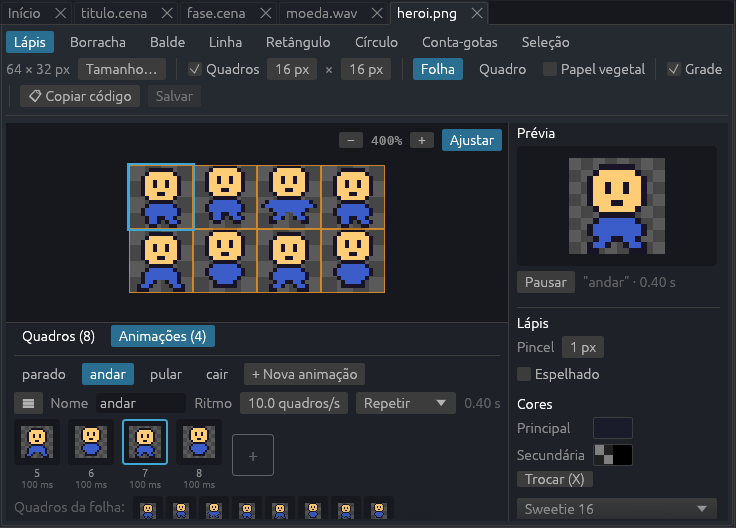

- **Ferramentas** (com atalho): **Lápis** (B), **Borracha** (E), **Balde**
  (G: pinta a área da mesma cor), **Linha** (L), **Retângulo** (R),
  **Círculo** (O), **Conta-gotas** (I) e **Seleção** (M). Botão esquerdo
  pinta com a cor principal; o direito, com a secundária (que começa
  transparente: apaga). Alt+clique pega a cor com qualquer ferramenta.
  Shift deixa a linha reta e o retângulo e o círculo, iguais dos lados;
  Shift+clique com o lápis faz uma linha desde o último ponto.
- À direita: o tamanho do **pincel** ([ e ] mudam), **Preenchido** (retângulo
  e círculo) e **Espelhado**, que desenha dos dois lados do quadro ao mesmo
  tempo (bom para personagens de frente).
- **Cores:** principal e secundária (X troca), e as paletas: as cores
  desta imagem, a **paleta do projeto** (arquivo `paleta.hex`, para usar as
  mesmas cores em todas as imagens) e paletas prontas (Sweetie 16, PICO-8,
  Endesga 32).
- **Seleção:** arraste para selecionar; arraste a seleção para mover.
  Ctrl+C, Ctrl+X, Ctrl+V (entre imagens também), Delete apaga, Enter ou Esc
  solta. **↔ / ↕ / Girar** espelham ou giram a seleção (ou o quadro todo).
- **Vista:** role o mouse para aproximar (no ponto do mouse); arraste com o
  botão do meio ou com Espaço para mover. **Ajustar** cabe tudo na tela.
  **Grade** mostra os pixels de perto.
- **Tamanho…** muda o tamanho da imagem (o desenho fica no canto de cima, à
  esquerda). **Copiar código** copia o `nn.assets.texture(...)` ou o
  `nn.assets.sheet(...)`.
- Ctrl+Z / Ctrl+Y desfazem e refazem; Ctrl+S salva. Uma aba com • tem
  alterações não salvas.

### Quadros

Marque **Quadros** e o tamanho de cada um (16 × 16, por exemplo) para dividir
a imagem numa folha de sprites. **Folha** mostra todos e **Quadro** só o atual,
maior. No painel de baixo (**Quadros**), clique num quadro para desenhar nele;
**+ Novo quadro** e **Duplicar** criam o próximo (duplicar é o jeito mais
rápido de fazer o passo seguinte de uma animação), **Excluir** tira, e ◀ ▶
mudam de lugar. As animações acompanham: tirar o quadro 3 faz o 4 virar o 3
nelas também. **Papel vegetal** mostra o quadro anterior clarinho por baixo
(o anterior na animação escolhida, se o quadro estiver nela).

O tamanho do quadro fica no arquivo de animações da imagem (abaixo); uma
imagem sem esse arquivo usa o tamanho que as cenas já usam para ela.

### Animações

Uma animação é uma sequência de quadros com nome: "parado", "andar",
"pular". Elas ficam num arquivo ao lado da imagem (`heroi.png` → `heroi.anim`)
e servem para qualquer cena ou prefab que use a imagem. No painel de baixo,
**Animações**:

- **+ Nova animação** cria uma (a primeira já vem com todos os quadros).
  Clique num nome para escolher; o ☰ usa todos os quadros, tira todos,
  duplica ou exclui.
- **Ritmo** (quadros por segundo) e **modo**: Repetir, Uma vez ou Ida e
  volta.
- A **linha do tempo** mostra os quadros da animação. Clique num **quadro da
  folha** (embaixo) para pôr no fim, ou arraste para o lugar certo; arraste
  dentro da linha do tempo para mudar a ordem. Botão direito num quadro: uma
  **duração** própria (um quadro mais longo, como num golpe) ou tirar da
  animação.
- A **Prévia** (à direita) toca a animação escolhida.

Para usar: no Inspetor, **Imagem > Animação** toca uma animação desde o
começo; na **Animação automática**, cada estado (parado, andando, pulando,
caindo) escolhe uma; os eventos têm **Tocar animação** e **Animação
terminar**; no Lua, `obj.sprite:play("andar")`
([guia do Lua](lua.md#animações-anim)). Os modelos Plataforma, Aventura e
Vazio já vêm com `heroi.anim` e `moeda.anim`.

## Mapas de tiles

Um mapa de tiles é uma fase montada com quadradinhos (tiles) de uma imagem só,
pintados numa grade. O NN Studio pinta os mapas **direto na cena** (ou na aba
do mapa) e grava no formato do [Tiled](https://www.mapeditor.org/) (`.tmj`, com
o tileset num `.tsj` ao lado da imagem): dá para abrir os mesmos arquivos no
Tiled, e o que você faz lá aparece aqui.

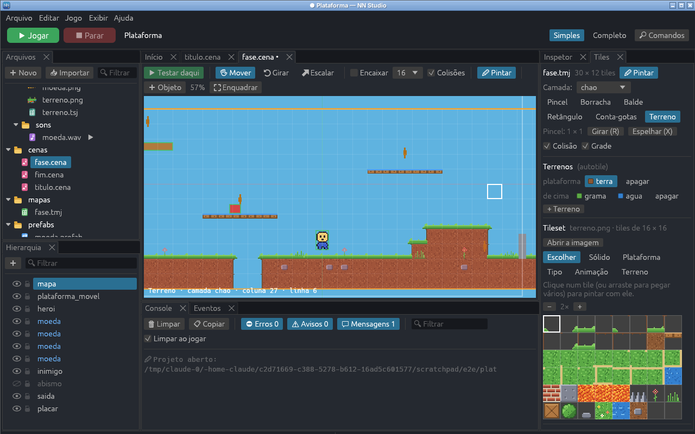

- **Mapa novo:** na cena, **➕ Objeto > Mapa de tiles...** (ou no painel Tiles).
  Escolha os tiles: um tileset do projeto, uma imagem (o `.tsj` é criado ao
  lado dela) ou uma imagem nova em branco para desenhar. O mapa vai para
  `mapas/` e o objeto já entra no modo Pintar. Os modelos Plataforma, Aventura
  e Vazio trazem `assets/imagens/terreno.png` e `terreno.tsj`.
- **✏ Pintar:** selecione o objeto do mapa e clique em **✏ Pintar** (na barra
  da cena ou no Inspetor). O mouse passa a pintar tiles; **Esc** sai. Rolar o
  mouse aproxima, botão do meio ou Espaço + arrastar move a vista. Pintar
  fora do mapa faz ele **crescer** (à esquerda e embaixo, o objeto anda junto
  para o desenho ficar no lugar).
- **Ferramentas** (painel **Tiles**): **Pincel** (B), **Borracha** (E),
  **Balde** (G), **Retângulo** (U), **Conta-gotas** (I, ou botão direito em
  qualquer ferramenta) e **Terreno** (T). Clique num tile do tileset, ou
  arraste para pegar vários: o pincel pinta o pedaço inteiro. **Ctrl +
  arrastar** no mapa copia um pedaço para o pincel. **R** gira o pincel 90°,
  **X** espelha (Shift+X, na vertical): os tiles ficam girados no mapa, como
  no Tiled.
- **Terrenos (autotile):** escolha um terreno (terra, grama, água) e pinte: as
  bordas e os cantos se encaixam sozinhos, com 16 peças (cantos do Tiled).
  **apagar** tira o terreno e acerta as bordas em volta. Uma célula pintada
  com o terreno é o terreno inteiro; as peças das vizinhas só levam a borda
  (a grama por cima, a areia na margem), então o que bloqueia é exatamente o
  que você pintou. Peças com mais de uma opção são sorteadas pela
  probabilidade de cada uma (uma grama com flores de vez em quando).
- **+ Terreno** cria um terreno seu: as 16 peças entram no fim da imagem do
  tileset, já com os cantos marcados e pintadas como guia. **Abrir a imagem**
  leva ao [editor de pixel art](#editor-de-pixel-art) para desenhar por cima.
- **Camadas:** o mapa tem camadas pintadas uma por cima da outra (o chão, os
  enfeites, a frente). Cada uma pode ficar escondida, **travada** (não pinta)
  ou ser uma camada de **colisão** (tudo nela bloqueia). Clique duas vezes
  para renomear; **Subir**, **Descer**, **Excluir** e a **opacidade**. O
  pincel pinta na camada escolhida (também no alto do painel).
- **Marcar os tiles:** **Sólido** (bloqueia), **Plataforma** (de mão única:
  dá para pular por baixo), **Tipo** (um nome como `lava`, `agua`, `tijolo`,
  para os eventos), **Animação** (clique num tile e Ctrl+clique nos que vêm
  depois; cada quadro tem a sua duração) e **Terreno** (clique nos cantos de
  cada tile para dizer de qual terreno é cada canto). A marcação fica no
  tileset e vale para todos os mapas que usam ele. **Colisão** mostra o que
  bloqueia (vermelho) e as plataformas (azul) por cima do mapa.
- **Ao vivo:** com o jogo aberto (F6), o que você pinta dentro do mapa aparece
  no jogo na hora, com a colisão. Quando o mapa cresce, o jogo vê ao salvar.
- **Aba do mapa:** clicar num `.tmj` abre o mapa sozinho, com o mesmo pincel.
  **Abrir no Tiled** abre no programa padrão. Mapas que o editor não sabe
  pintar (infinitos, camadas compactadas em base64, tilesets `.tsx`) mostram
  a prévia e o motivo. Tilesets que estão dentro do mapa (do Tiled) se pintam
  normalmente; para marcar tiles neles, **Separar num arquivo .tsj**.
- **Desfazer e salvar:** Ctrl+Z desfaz cada pincelada (na cena, enquanto
  pinta, ou na aba do mapa). Ctrl+S na cena salva a cena, os mapas dela e os
  tilesets juntos; a aba da cena ganha o • quando o mapa tem alterações.

Nos [eventos](#eventos-quando-então), **Encostar num tile** (de um tipo, ou
qualquer um) e **Trocar o tile tocado** fazem lava, espinhos, água e blocos
que quebram; **Trocar o tile em um objeto** troca o tile onde um objeto está.
O campo de tile tem um **…** para escolher no tileset. No Lua:
`obj:tiles_touching()`, `mapa:tiles_in(...)` e `mapa:tile_properties(...)`
([guia do Lua](lua.md#nntilemap)).

## Imagens, sons e mapas

- **Imagens:** abrem no [editor de pixel art](#editor-de-pixel-art). Imagens
  que não são PNG (a engine só lê PNG) mostram um aviso.
- **Sons:** forma de onda, ▶ Tocar e o código `nn.assets.sound(...)`.
- **Mapas do Tiled (.tmj):** abrem no [editor de mapas](#mapas-de-tiles).
  Ao salvar no Tiled, o editor e o jogo aberto atualizam.

## Jogar

- **▶ Jogar (F5)** salva tudo e abre o jogo na janela dele. Com o jogo aberto,
  salve um arquivo: a mudança aparece na hora, sem fechar o jogo.
- **▶ Testar daqui (F6)**, numa cena visual, começa o jogo nela (veja
  [Testar daqui e ajuste ao vivo](#testar-daqui-e-ajuste-ao-vivo)).
- **⟳ Reiniciar (F5)** fecha e abre o jogo de novo; **⏹ Parar (Shift+F5)**
  fecha.
- O **Console** recebe o que o jogo escreve com `print()`, os avisos e os
  erros. Erros aparecem em português, e cada `arquivo.lua:12` é um link: clique
  para abrir o arquivo nessa linha. Se o console estiver escondido quando
  chegar um erro, ele aparece sozinho.
- Um arquivo que falta numa cena (um modelo, um som, uma conversa) não fecha o
  jogo: vira um aviso no console com o objeto e o arquivo, e um modelo que
  falta aparece como um cubo rosa.
- Filtros do console: **Erros**, **Avisos** e **Mensagens** (e **Engine**, no
  modo Completo). **Limpar ao jogar** começa cada partida com o console limpo.

## Configurações do projeto

**Editar > Configurações do projeto** (ou o botão no Início) mostra um
formulário com o título, o tamanho da janela, o **tamanho do jogo**, tela
cheia, cor de fundo e a cena inicial (uma cena em código ou uma cena visual),
além das
[variáveis do jogo](#variáveis-do-jogo-e-hud): nome e valor inicial (número,
texto ou sim/não), e o [tema da interface](#interface-menus-e-hud). No modo Completo também o identificador dos saves, VSync,
janela redimensionável, recarregar ao salvar e passos fixos por segundo. Tudo
fica no `config.lua`: o NN Studio troca só os valores, sem mexer nos seus
comentários.

**Tamanho do jogo:** com **Fixo** marcado, o jogo enxerga sempre o mesmo
tamanho (por exemplo 1280 × 720 ou 640 × 360) e se ajusta à janela, maior ou
menor, sem cortar nada: **Ajustar** mantém a proporção (com faixas pretas
quando a janela é de outra proporção), **Esticar** ocupa tudo e **Pixel art**
só aumenta em números inteiros (2×, 3×...), para os pixels ficarem nítidos. O
retângulo "tela do jogo" na cena passa a ter esse tamanho. Os modelos novos já
vêm com 1280 × 720.

## Exportar

**Jogo > Exportar jogo...** gera o executável único do jogo (o mesmo do
`nn exportar`), na pasta `dist` do projeto ou na que você escolher. Antes,
os scripts são conferidos: com erro de sintaxe, a exportação não acontece e a
mensagem diz onde está o erro.

## Atalhos

| Atalho | Comando |
|---|---|
| F5 / Shift+F5 | Jogar (ou reiniciar) / Parar |
| F6 | Testar a partir da cena visual aberta |
| Ctrl+S / Ctrl+Shift+S | Salvar / Salvar tudo |
| Ctrl+Z / Ctrl+Y | Desfazer / refazer (na cena visual, nos mapas e no editor de pixel art) |
| Ctrl+N | Nova cena visual |
| Ctrl+Shift+N / Ctrl+O | Novo projeto / Abrir projeto |
| Ctrl+Shift+P / Ctrl+P | Paleta de comandos / Abrir arquivo |
| Ctrl+F / Ctrl+H / Ctrl+G | Buscar / Substituir / Ir para a linha |
| Ctrl+/ | Comentar linhas |
| Ctrl+Espaço | Autocompletar (no editor de código) |
| Tab / Shift+Tab | Recuar / desfazer recuo |
| Ctrl+W | Fechar aba |
| Ctrl+= / Ctrl+- / Ctrl+0 | Aumentar / diminuir / tamanho normal da interface |
| F2 / Del (no painel) | Renomear / mandar para a lixeira |
| W / E / R (na cena) | Mover / girar / escalar |
| F / Esc (na cena) | Enquadrar / limpar a seleção |
| Setas, Shift+setas (na cena) | Mover 1 / 10 unidades |
| Ctrl+D / Del (na cena) | Duplicar / apagar |
| Ctrl+clique (na janela do jogo) | Selecionar o objeto no editor |
| Botão direito + WASD, Q/E (na cena 3D) | Voar pela cena |
| Alt + arrastar / botão do meio (na cena 3D) | Girar em volta / arrastar a vista |
| B E G L R O I M (na imagem) | Lápis, borracha, balde, linha, retângulo, círculo, conta-gotas, seleção |
| X / [ ] / H (na imagem) | Trocar as cores / tamanho do pincel / espelhar |
| , / . (na imagem) | Quadro anterior / próximo |
| B E G U I T (pintando um mapa) | Pincel, borracha, balde, retângulo, conta-gotas, terreno |
| R / X / Shift+X (pintando um mapa) | Girar / espelhar / espelhar na vertical o pincel |
| Ctrl + arrastar / botão direito (pintando) | Copiar um pedaço / pegar o tile |
| F1 | Guia do Lua |

A lista também está em **Ajuda > Atalhos do teclado**.

## Onde ficam as preferências

Projetos recentes, tema, modo, tamanho da interface e layouts ficam num
arquivo `preferencias.json` na pasta de configuração do usuário
(`%APPDATA%\NN Studio\config` no Windows, `~/.config/nnstudio` no Linux). Os
projetos não ganham nenhum arquivo do editor: a pasta do jogo continua só com
o jogo.

Na mesma pasta fica o **log** do editor, `nn-studio.log` (o da vez anterior
fica em `nn-studio.log.1`). Se o NN Studio fechar por um erro, na próxima vez
que abrir ele avisa, com o erro para copiar e um botão para abrir a pasta do
log. **Ajuda > Sobre** mostra a versão e também abre essa pasta.

Com a janela do editor sem foco ou minimizada (enquanto você joga, por
exemplo), as animações e partículas da cena param de redesenhar e o editor
quase não usa o processador.

## Como funciona por dentro

- O editor é feito com [egui](https://github.com/emilk/egui) e
  [egui_dock](https://github.com/Adanos020/egui_dock), desenhados pelo mesmo
  wgpu da engine.
- ▶ Jogar roda o próprio `nn-studio` com `--jogar <pasta>` num processo
  separado. O jogo escreve o log numa linha por mensagem (`@nn {json}`) e o
  editor lê. Se o jogo travar, o editor continua de pé.
- As mensagens de erro do Lua são traduzidas pela própria engine
  (`nn_script::translate_error`), então a tela de erro do jogo também fica em
  português.
- As cenas visuais são lidas por um módulo Lua dentro da engine
  (`crates/nn-script/src/cena.lua`). A lista de componentes e dos valores
  padrão dele é a mesma que o Inspetor usa. Na aba da cena, o editor desenha
  com o renderer da engine na GPU do próprio editor.
- **Testar daqui** roda `nn-studio --jogar <pasta> --cena <arquivo>`. O ajuste
  ao vivo vai pela entrada padrão do jogo, uma linha JSON por mudança
  (`{"scene": "cenas/fase.cena", "id": 3, "field": "x", "value": 120}`, ou
  `{"cmd": "pause"}`, `"resume"`, `"step"`). O jogo responde pelo log: qual
  cena está na frente, o estado dos objetos (10 vezes por segundo, em JSON) e
  o objeto do Ctrl+clique.
- Os comportamentos prontos são módulos Lua dentro da engine
  (`crates/nn-script/src/comportamentos/`), escritos com a mesma API que um
  script seu usaria. O Inspetor lê a lista de propriedades de cada um rodando
  o módulo num Lua separado, sem o jogo.
- O autocompletar e as descrições vêm de `nn_script::api_docs`, a mesma lista
  que um teste confere contra a API de verdade.
- Os eventos rodam num módulo Lua da engine
  (`crates/nn-script/src/eventos.lua`), que também descreve cada condição e
  ação (frase, campos e o Lua equivalente). O painel Eventos monta os menus e
  as frases a partir dessa descrição. Mudanças nas regras vão para o jogo
  aberto como `{"id": 0, "field": "events", "value": [...]}` (id 0 = regras
  da cena), e o estado que o jogo manda diz quais regras dispararam.
- O tutorial confere o projeto a cada quadro; os painéis marcam onde estão os
  botões que ele destaca.
- O editor de pixel art guarda o desenho na memória e grava o PNG com a
  biblioteca `image`. Os arquivos `.anim` são tabelas Lua lidas pela própria
  engine (`cena.lua`, `parse_anims`) e pelo NN Studio no mesmo formato.
- Os mapas são lidos e gravados no formato JSON do Tiled (o que o editor não
  conhece, como objetos e propriedades, fica como estava). Na cena, o mapa
  aberto é desenhado pelo renderer da engine a partir do que está na memória,
  sem salvar; na aba do mapa, o egui desenha os tiles. Os giros seguem os bits
  do Tiled (diagonal, horizontal, vertical). O ajuste ao vivo dos tiles vai
  como `{"field": "tiles", "value": [["camada", coluna, linha, tile], ...]}`
  e o jogo chama `set_tile`, que também acerta a colisão.
- Repetir a imagem é feito no shader de sprites: cada sprite tem quantas
  vezes a região se repete, então um chão de 20 blocos continua sendo um
  desenho só.

## O que vem depois

A próxima etapa é a **v0.1**: acabamento, revisão dos tutoriais e dos
modelos, e o NN Studio pronto para instalar.
